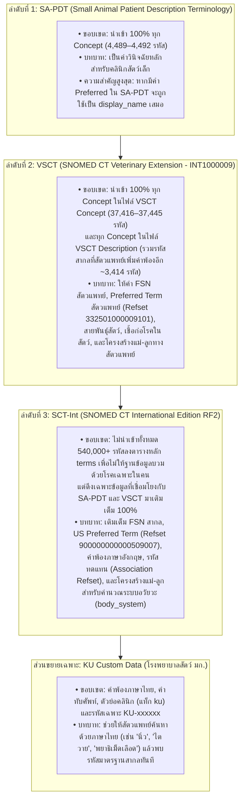

# การจัดลำดับความสำคัญ 3 แหล่งอ้างอิง (`SA-PDT > VSCT > SCT-Int`) และวิวัฒนาการของฟิลด์ข้อมูลในโปรเจกต์ KAHIS Terminology

> **วันที่จัดทำเอกสาร:** 6 พฤศจิกายน 2026  
> **วัตถุประสงค์:** อธิบายหลักการผสานข้อมูลจาก 3 แหล่งมาตรฐานสากลร่วมกับคำพ้องของโรงพยาบาลสัตว์ มก. (`KU Custom`), วิเคราะห์การนำแต่ละฟิลด์ไปใช้งานจริง และสรุปความแตกต่างของการใช้ `display_name` รวมถึงฟิลด์อื่นๆ ตั้งแต่ยุคเริ่มต้นโปรเจกต์จนถึงปัจจุบัน

---

## 1. หลักการผสานข้อมูล 3 แหล่งอ้างอิงตามลำดับความสำคัญ (`1. SA-PDT > 2. VSCT > 3. SCT-Int`)

โปรเจกต์ KAHIS Terminology ออกแบบมาเพื่อใช้ในระบบเวชระเบียนของโรงพยาบาลสัตว์ มหาวิทยาลัยเกษตรศาสตร์ โดยมีหลักการสำคัญคือ **"ให้ความสำคัญกับคำศัพท์ทางคลินิกของสัตวแพทย์สัตว์เล็กเป็นอันดับแรก ตามด้วยส่วนขยายสัตวแพทย์ทั้งหมด และใช้ฐานข้อมูลการแพทย์สากลเป็นฐานเติมเต็มความสมบูรณ์"**



---

## 2. เปรียบเทียบการใช้ `display_name` (ตอนแรกของโปรเจกต์ vs ปัจจุบัน)

คอลัมน์ **`display_name`** คือชื่อหลักของคำศัพท์ที่แสดงในคอลัมน์ซ้ายของตารางผลการค้นหา และเป็นชื่อหัวเรื่องใหญ่ในการ์ดสีฟ้า (Concept Details) ซึ่งมีการเปลี่ยนแปลงสำคัญ 3 ยุค ดังนี้:

| ประเด็นเปรียบเทียบ | ยุคแรก (`v1.0 – v4.9.1`) | ยุคกลาง (`v5.0` แก้บั๊กไฟล์ภาษา) | ยุคปัจจุบัน (`v6.0+` มาตรฐานสมบูรณ์) |
| :--- | :--- | :--- | :--- |
| **1. ไฟล์ต้นทางที่ใช้อ่านชื่อ** | อ่านจากไฟล์ CSV สำเร็จรูป (`terminology_master_31cols.csv`) ต่อมาเมื่อเปลี่ยนมาอ่านไฟล์ RF2 โดยตรง เกิดบั๊ก `glob` ไปหยิบไฟล์ภาษาสเปน (`sct2_Description_Snapshot-es`) ก่อนไฟล์ภาษาอังกฤษ (`-en`) | บังคับอ่านไฟล์ภาษาอังกฤษ (`-en`) ได้ถูกต้อง แต่**ยังไม่ได้อ่านไฟล์ `der2_cRefset_LanguageSnapshot-en`** ทำให้สคริปต์ไม่ทราบว่า Synonym ตัวไหนคือ `Preferred Term (PT)` | อ่านไฟล์ **Language Refset ทั้งของ VSCT (`332501000009101`) และ SCT-Int (`900000000000509007`)** ทำให้แยกแยะระหว่าง `FSN`, `Preferred Term`, และ `Acceptable Synonym` ได้ 100% |
| **2. สูตรการคัดเลือก `display_name`** | `SA-PDT Preferred` ➔ ข้ามไปดึง `SCT-Int FSN` (ไม่ได้ดึงจาก `VSCT` เป็น Fallback) | `SA-PDT Preferred` ➔ `SCT-Int FSN` ➔ `VSCT FSN` (ลำดับผิด เพราะเอา SCT-Int ทับ VSCT และใช้ FSN แทน PT) | **เรียงตามลำดับความสำคัญ 3 แหล่งอย่างเคร่งครัด:**<br>1. `SA-PDT Preferred`<br>2. `VSCT Vet Preferred` (`332501000009101`)<br>3. `SCT-Int US Preferred` (`900000000000509007`)<br>4. Fallback: `FSN` ที่ตัดวงเล็บท้ายออก (`strip_fsn_tag`) |
| **3. ลักษณะการแสดงผลบนหน้าเว็บ** | รหัสที่เป็น VSCT-only จำนวน **32,749 รายการ** ไม่มีชื่อแสดงผล กลายเป็น**ตัวเลขรหัสล้วนๆ** (เช่น `34261000009105`) | แสดงชื่อภาษาอังกฤษครบ แต่รหัสที่อยู่นอก SA-PDT ทั้ง **35,817 รายการ** มีวงเล็บ Semantic Tag ติดท้ายชื่อทุกตัว (เช่น `Ulcerative gastroenteritis (disorder)`) ในขณะที่รหัส SA-PDT ไม่มีวงเล็บ ทำให้หน้าตาข้อมูลไม่เป็นมาตรฐานเดียวกัน | **ชื่อหลัก (`display_name`) สะอาด ไม่มีวงเล็บติดท้ายเหมือนกันทั้งฐานข้อมูล** เช่น:<br>• `Bladder stone` (จาก SA-PDT)<br>• `Ulcerative gastroenteritis` (จาก VSCT PT)<br>• `Hepatolithiasis` (จาก VSCT PT)<br>ส่วนชื่อเต็มที่มีวงเล็บจะแสดงในคอลัมน์ **`snomed_fsn`** ด้านขวาอย่างเป็นระเบียบ |
| **4. การแสดงผลเมื่อยกเลิกการจัดกลุ่ม (`Group by concept = Off`)** | แสดงเฉพาะแถวหลัก (`1 Concept = 1 แถว`) เสมอ | ขยายแถวเฉพาะคำพ้องใน SA-PDT | เมื่อผู้ใช้เอาเครื่องหมายถูกที่ `Group by concept` ออก ระบบใน `server.py` จะแตกแถวคำพ้องทุกตัวที่ตรงกับคำค้นหาขึ้นมาแสดงในคอลัมน์ `display_name` พร้อมระบุในช่อง FSN ว่า `(Synonym of <ชื่อหลัก>)` |

---

## 3. วิวัฒนาการและการเปลี่ยนแปลงของฟิลด์อื่นๆ ในการนำไปใช้งานจริง

นอกเหนือจาก `display_name` แล้ว ฟิลด์และกลไกอื่นๆ ของโปรเจกต์ได้รับการปรับปรุงจากยุคแรกมาสู่ยุคปัจจุบันใน **8 ประเด็นหลัก** ดังนี้:

### 3.1 การคัดเลือก `snomed_fsn` (Fully Specified Name) และ `snomed_semantic_type`
* **ยุคแรก:**
  - ใน `build_direct_db.py` ยุคแรก เขียนลำดับเป็น `sct_desc.get('fsn') or vsct_desc.get('fsn')` และในตาราง `concept_terms` โหลดไฟล์ `SCT-Int` ก่อน `VSCT` แล้วใช้ `INSERT OR IGNORE` ทำให้ชื่อเต็มที่ทางสัตวแพทย์ (VSCT) ปรับปรุงใหม่ถูกชื่อของฝั่งคน (SCT-Int) ทับ
* **ปัจจุบัน:**
  - ใช้ลำดับ **`VSCT FSN (Active) > SCT-Int FSN (Active) > Inactive FSN`** เสมอ
  - เนื่องจากในไฟล์ `SA-PDT` ไม่มีแถวที่เป็น FSN เลย (`0` แถว) ระบบจึงดึง FSN จาก VSCT และ SCT-Int มาเติมให้ครบ 100% ทุก Concept
  - สกัดคำในวงเล็บท้ายสุดของ `snomed_fsn` (เช่น `(disorder)`, `(finding)`, `(organism)`) มาใส่ในฟิลด์ **`snomed_semantic_type`** เพื่อใช้สร้างตัวกรองหมวดหมู่ด้านซ้ายของหน้า Browser

### 3.2 การขยายขอบเขตข้อมูล `VSCT` ให้ครบทุกตัว (`40,306` ➔ `42,299+` Concepts)
* **ยุคแรก:**
  - สคริปต์อ่านเฉพาะไฟล์ `sct2_Concept_Snapshot` ของ VSCT (`37,416` รหัส) เมื่อรวมกับ SA-PDT จึงมีทั้งหมด `40,306` แถว
  - **ปัญหาที่พบ:** มีรหัสมาตรฐานสากล (`SCT-Int`) อีก **`3,414` รหัส** ที่ทางสัตวแพทย์ (VTSL) ไม่ได้สร้างรหัส Concept ใหม่ แต่ไป**เพิ่มคำพ้องสัตวแพทย์ไว้ในไฟล์ `sct2_Description_Snapshot-en` ของ VSCT**
    - ในจำนวนนี้ มี `1,421` รหัสที่อยู่ใน SA-PDT ด้วย (เช่น `95570007` *Renal calculi*, `70650003` *Bladder stone*) ซึ่งเดิมถูกตั้งค่าผิดเป็น `in_vsct = 'No'`
    - และมีอีก **`1,993` รหัส** ที่ไม่อยู่ใน SA-PDT (เช่น `297288000` *Hepatolithiasis / Liver calculus*) ซึ่งตกหล่นไปจากตาราง `terms` ในยุคแรก
* **ปัจจุบัน:**
  - ขอบเขตของตาราง `terms` คือ **`SA-PDT ∪ VSCT Concept ∪ VSCT Description`** ทำให้เก็บครบทั้ง `42,299` รหัส (ในรุ่น `20260331`) และ `42,331` รหัส (ในรุ่น `20260930`) พร้อมตั้งค่า `in_vsct = 'Yes'` ให้กับรหัสที่มีคำศัพท์ใน VSCT Description อย่างถูกต้อง

### 3.3 ระบบคำพ้อง (`synonym`, `snomed_all_synonyms`, และ `ku_synonym_text`)
* **ยุคแรก:**
  - คอลัมน์ `synonym` เก็บเฉพาะคำพ้องจาก SA-PDT เท่านั้น ส่วน `snomed_all_synonyms` เก็บคำพ้องจาก RF2 แต่ไม่ได้ถูกนำไปใส่ใน `WHERE` ของ SQL ตอนค้นหา!
  - เวลาสั่งกด **Rebuild DB** ตารางคำพ้องภาษาไทย `ku_synonym_text` จะถูกล้างทิ้งเป็น `0` แถว
  - เวลาค้นหาคำภาษาไทย เช่น `"นิ่ว"` ตารางผลลัพธ์แสดง `13` รายการ แต่ตัวเลขหน้าหมวดหมู่ด้านซ้าย (`Semantic Tag Filter`) แสดง `disorder (0)` เพราะคิวรีนับจำนวนไม่ได้เชื่อมกับตาราง `ku_synonym_text`
* **ปัจจุบัน:**
  - คอลัมน์ `synonym` รวมคำพ้องภาษาอังกฤษทุกคำจาก `SA-PDT ∪ VSCT ∪ SCT-Int` ที่ไม่ซ้ำกับ `display_name`
  - แก้ไข SQL ใน `server.py` ให้ทั้งการค้นหาหลักและการนับ `semantic_counts` ค้นหาครอบคลุมทั้ง `display_name`, `synonym`, `snomed_fsn`, `snomed_preferred_term`, `snomed_all_synonyms` และตาราง `ku_synonym_text` (ค้นหา `"นิ่ว"` ได้ตัวเลขหมวดหมู่ตรงกัน 100%: `disorder = 12`, `morphologic abnormality = 1`)
  - **กลไก Update-Safe:** ทุกครั้งที่สั่ง Rebuild DB สคริปต์จะดึงข้อมูลจากตาราง `ku_synonym_text` เดิม + ไฟล์ `ku_custom_synonyms.csv` + Cloud Firestore กลับมาใส่ให้ครบโดยไม่สูญหาย

### 3.4 การคำนวณหมวดหมู่ระบบอวัยวะ (`body_system`) อัตโนมัติ
* **ยุคแรก:**
  - คอลัมน์ `body_system` ใน `build_direct_db.py` ถูกปล่อยว่าง `''` ทุกแถว (ต้องรันสคริปต์แยก `build_body_system.py` ซึ่งไม่ได้ผูกกับปุ่ม Rebuild)
* **ปัจจุบัน:**
  - ผสานอัลกอริทึม **BFS Graph Traversal (ไต่กราฟความสัมพันธ์ 12 ระดับชั้น)** เข้าไปใน `build_direct_db.py` โดยตรง:
    1. ตรวจสอบความสัมพันธ์ `Finding site` (`363698007`) และ `Procedure site` (`363704007`) ของแต่ละ Concept
    2. ไต่กราฟแม่-ลูก (`Is a` = `116680003`) ย้อนขึ้นไปสูงสุด 12 ชั้น จนพบ Concept ต้นตอของระบบอวัยวะ (`BODY_SYSTEM_MAP` และลูกของ `280115004 Body system structure`)
    3. จัดหมวดหมู่ให้ครบ 100% ทุกแถว (เช่น `Urinary system`, `Digestive system`, `Cardiovascular system`, `Musculoskeletal system`, `Nervous system` ฯลฯ) และนำไปแสดงในส่วน **Attributes** ของหน้ารายละเอียดคำศัพท์

### 3.5 ตรรกะการกรองสถานะ `Active` vs `Inactive`
* **ยุคแรก:**
  - เช็คเฉพาะว่าถ้าอยู่ใน SA-PDT ต้องมี `sapdt_status = 'Active'` เท่านั้น ทำให้คำศัพท์ **339 รายการ** ที่ถูกปรับเป็น `Retired` ใน SA-PDT แต่**ยังคง `Active` อยู่ในมาตรฐานสัตวแพทย์ VSCT** ถูกซ่อนหายไปจากการค้นหา
* **ปัจจุบัน:**
  - ใช้ตรรกะ **`OR` (หากยัง Active อยู่ในแหล่งใดแหล่งหนึ่ง ให้ถือว่าใช้งานได้)**:
    ```sql
    ((in_sapdt = 'Yes' AND sapdt_status = 'Active') OR (in_vsct = 'Yes' AND snomed_active = 'Yes'))
    ```
  - ส่วนรายการที่เป็น `Inactive` คือรายการที่ถูกยกเลิกทั้งใน SA-PDT และ VSCT ซึ่งผู้ใช้ยังสามารถเปิดดูได้โดยเปลี่ยนตัวกรอง Status เป็น `Active and inactive concepts` หรือ `Inactive concepts only`

### 3.6 รหัสทดแทน (`replacement_concept_id`) และประเภทการเปลี่ยนแปลง (`sapdt_change_type`)
* **ยุคแรก:**
  - คอลัมน์ `replacement_concept_id` และ `sapdt_change_type` เป็นค่าว่าง `''` ทั้งหมด
* **ปัจจุบัน:**
  - อ่านไฟล์ `der2_cRefset_AssociationSnapshot` ของทั้ง VSCT และ SCT-Int (`SAME AS`, `REPLACED BY`, `POSSIBLY EQUIVALENT TO`) เพื่อเติมรหัส Concept ใหม่ที่เข้ามาแทนที่รหัสเก่าที่ถูกยกเลิก (`replacement_concept_id`) พร้อมย้ายคำพ้องภาษาไทย `ku` ตามไปยังรหัสใหม่ให้อัตโนมัติ
  - อ่านไฟล์ Delta ของ SA-PDT (`SA-PDTReleaseFile_*to*.txt` / `ReleaseFile_*to*.xml`) เพื่อนำประเภทการเปลี่ยนแปลงของรอบล่าสุด (`New Concept`, `Retired Concept`, `Description Preference Change`, `New Description`, `Retired Description`) มาเติมลงในคอลัมน์ `sapdt_change_type`

### 3.7 สัญลักษณ์หน้าคำศัพท์ (`≡` vs `○`) และการวาดผัง Diagram
* **ยุคแรก:**
  - ใช้ `snomed_semantic_type` มาตัดสินว่าถ้าเป็น `finding` หรือ `disorder` ให้แสดงจุดกลม `●` นอกนั้นแสดง `≡` ซึ่งไม่ตรงตามมาตรฐานสากลของ SNOMED CT
* **ปัจจุบัน:**
  - ใช้คอลัมน์ `snomed_definition_status` ตามมาตรฐาน SNOMED CT Official Browser:
    - **`≡` (Fully Defined):** `snomed_definition_status = '900000000000073002'`
    - **`○` (Primitive):** `snomed_definition_status = '900000000000074008'`
  - แสดงผลตรงกันทั้งในตารางผลการค้นหา รายการ Parents/Children และในแท็บ **Diagram** (ซึ่งวาดผัง SVG ตามมาตรฐาน SNOMED CT Diagramming Guideline พร้อมปุ่มดาวน์โหลดไฟล์ `.svg`)

---

## 4. สรุปโครงสร้างทั้ง 32 คอลัมน์ของตาราง `terms` และการนำไปใช้งานในโปรเจกต์

| ลำดับ | ชื่อคอลัมน์ | แหล่งที่มา / วิธีสร้าง | การนำไปใช้งานจริงในระบบ (`server.py` / `app.js` / เวชระเบียน KAHIS) |
| :---: | :--- | :--- | :--- |
| 1 | `id` | `AUTOINCREMENT` | Primary Key ประจำแถว |
| 2 | `display_name` | `SA-PDT Pref > VSCT Pref > SCT-Int Pref` | ชื่อหลักแสดงในตารางผลการค้นหาและหัวข้อหน้ารายละเอียด |
| 3 | `in_sapdt` | `'Yes'` / `'No'` | แสดงป้ายกำกับ `[SA-PDT]` สีน้ำเงิน และใช้กรองขอบเขตข้อมูล |
| 4 | `in_vsct` | `'Yes'` / `'No'` | แสดงป้ายกำกับ `[VSCT]` สีเขียว และใช้กรองขอบเขตข้อมูล |
| 5 | `in_sct_inter` | `'Yes'` / `'No'` | แสดงป้ายกำกับ `[SCT-Inter]` สีเทาในหน้ารายละเอียด |
| 6 | `sapdt_concept_id` | รหัส Concept ใน SA-PDT หรือ `KU-xxxxxx` | ใช้ค้นหาด้วยรหัส และรองรับรหัสเฉพาะที่ รพ. สร้างเองในอนาคต |
| 7 | `sapdt_status` | `'Active'` / `'Retired'` / `''` | ใช้คำนวณสถานะ Active/Inactive ร่วมกับ `snomed_active` |
| 8 | `sapdt_change_type` | ดึงจากไฟล์ SA-PDT Changes (`*to*`) | บันทึกประวัติการเปลี่ยนแปลงใน Release ล่าสุด (เช่น `New Concept`, `Retired Concept`) |
| 9 | `sapdt_description_id` | รหัส Description ID ใน SA-PDT คั่นด้วย ` \| ` | รองรับการพิมพ์ค้นหาด้วยเลข Description ID ของ SA-PDT |
| 10 | `sapdt_fsn` | เก็บค่าเดียวกับ `sapdt_preferred` | คงไว้เพื่อความเข้ากันได้ย้อนหลัง (เนื่องจาก SA-PDT ไม่มี FSN) |
| 11 | `sapdt_preferred` | คำศัพท์ที่ `ISDISPLAY = Preferred` ใน SA-PDT | ใช้เป็นตัวเลือกอันดับ 1 ของ `display_name` |
| 12 | `sapdt_acceptable` | คำศัพท์ที่ `ISDISPLAY = Acceptable` ใน SA-PDT | เก็บรายการคำพ้องเฉพาะที่กำหนดใน SA-PDT |
| 13 | `synonym` | รวมคำพ้องทุกแหล่ง (`SA-PDT ∪ VSCT ∪ SCT-Int`) | ใช้เป็นดัชนีค้นหาหลักและขยายแถวเมื่อปิด `Group by concept` |
| 14 | `sapdt_semantic_type` | ค่าเดียวกับ `snomed_semantic_type` (เฉพาะ SA-PDT) | ใช้ตรวจสอบหมวดหมู่ของรายการใน SA-PDT |
| 15 | `snomed_concept_id` | รหัส SNOMED CT Concept ID (SCTID) | รหัสอ้างอิงหลักสำหรับเชื่อมโยง Parents, Children, Attributes และเวชระเบียน |
| 16 | `snomed_fsn` | `VSCT FSN > SCT-Int FSN` | แสดงในคอลัมน์ขวาของตารางผลลัพธ์ และในกรอบสีฟ้าของหน้ารายละเอียด |
| 17 | `snomed_preferred_term` | ดึงจาก Language Refset (`VSCT > SCT-Int`) | แสดงในรายการ Descriptions (ป้าย `Preferred`) และใช้เป็นลำดับที่ 2–3 ของ `display_name` |
| 18 | `snomed_all_synonyms` | รวมคำพ้องจาก `VSCT (-en) ∪ SCT-Int (-en)` | แสดงในรายการ Descriptions (ป้าย `Synonym`) และใช้ในการค้นหา |
| 19 | `snomed_active` | `'Yes'` (`active=1`) / `'No'` (`active=0`) | ใช้กรองสถานะ Active/Inactive และแสดงป้าย `Inactive` |
| 20 | `snomed_module` | `moduleId` จาก RF2 (`332351000009108` ฯลฯ) | ระบุโมดูลผู้ดูแลรหัส (โมดูลสัตวแพทย์ VTSL หรือโมดูลสากล) |
| 21 | `snomed_semantic_type` | สกัดจากวงเล็บท้าย `snomed_fsn` | ใช้สร้างรายการตัวกรอง **Semantic Tag Filter** ด้านซ้ายพร้อมตัวนับจำนวน (`count-pill`) |
| 22 | `body_system` | คำนวณด้วย BFS 12 ระดับชั้นจาก Finding/Procedure site | แสดงในกล่อง **Attributes (`Body system ➔ ...`)** และใช้จำแนกตามระบบอวัยวะ |
| 23 | `snomed_definition_status` | `900000000000073002` / `900000000000074008` | ใช้แสดงสัญลักษณ์ `≡` (Fully Defined) หรือ `○` (Primitive) และวาดผัง Diagram |
| 24 | `snomed_parent_concepts` | รหัส Concept แม่สายตรง (`Is a`) คั่นด้วย ` \| ` | เก็บรายการรหัสแม่สายตรงไว้ในตารางหลักเพื่อการส่งออก CSV ที่สมบูรณ์ |
| 25 | `match_type` | `'sapdt'` / `'vsct_only'` / `'ku_custom'` | แยกประเภทที่มาของแถวข้อมูล และใช้คำนวณสถิติบนหน้า Admin Dashboard |
| 26 | `concept_count` | `'1'` | คงไว้ตามโครงสร้างมาตรฐาน 32 คอลัมน์ |
| 27 | `all_snomed_concept_ids` | รหัส SCTID ที่ผูกอยู่ | รองรับกรณีรหัส `ku_custom` ผูกกับรหัส SNOMED มากกว่า 1 รหัสในอนาคต |
| 28 | `replacement_concept_id` | ดึงจาก `der2_cRefset_AssociationSnapshot` | ระบุรหัสใหม่ที่มาแทนที่รหัสที่ถูกยกเลิก (`Retired` / `Inactive`) |
| 29 | `match_confidence` | `'Exact'` | ระดับความเชื่อมั่นของการจับคู่รหัส |
| 30 | `updated_at` | `YYYY-MM-DD` | วันที่อัปเดตแถวข้อมูลล่าสุด |
| 31 | `updated_by` | `'system_rebuild_v6'` | ผู้ดำเนินการอัปเดตข้อมูล |
| 32 | `created_at` | `YYYY-MM-DD HH:MM:SS` | วันเวลาที่สร้างแถวข้อมูล |
