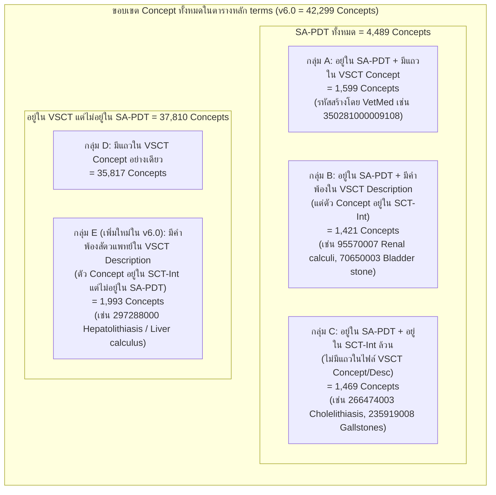
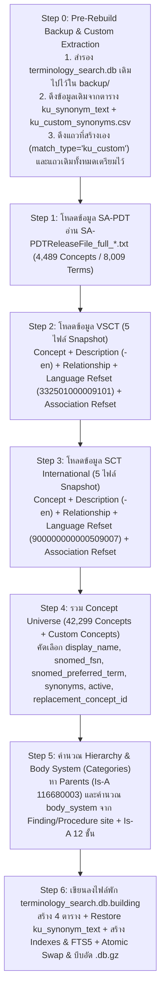
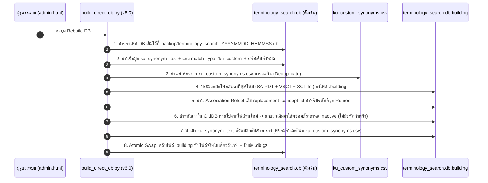

# KAHIS Terminology Database Builder — Master Architecture, Data Lineage & Operational Manual (v6.0)

> **เอกสารฉบับสมบูรณ์สำหรับผู้ใช้งาน (User/Admin) และนักพัฒนา / AI (Developer & AI Handover Specification)**
> **โครงการ**: ระบบฐานข้อมูลคำศัพท์สัตวแพทย์มาตรฐาน KAHIS (`SA-PDT` + `VSCT` + `SNOMED CT International` + `KU Custom`)
> **ไฟล์ฐานข้อมูลเป้าหมาย**: `terminology_search.db` (คงโครงสร้าง Schema เดิม 100% — Zero Breaking Changes)

---

## สารบัญ (Table of Contents)
1. [บทนำและหลักการออกแบบสำคัญ (Executive Summary & Core Principles)](#1-บทนำและหลักการออกแบบสำคัญ-executive-summary--core-principles)
2. [สรุปเวอร์ชันของแหล่งข้อมูลต้นฉบับ วันเดือนปี และไฟล์ที่ใช้ทั้งหมด](#2-สรุปเวอร์ชันของแหล่งข้อมูลต้นฉบับ-วันเดือนปี-และไฟล์ที่ใช้ทั้งหมด)
3. [สรุปจำนวนข้อมูลและสถิติเชิงลึกในหลายมิติ (Multi-Dimensional Data Statistics)](#3-สรุปจำนวนข้อมูลและสถิติเชิงลึกในหลายมิติ-multi-dimensional-data-statistics)
4. [วิเคราะห์เปรียบเทียบ: ระบบเดิม (v4.9.1) vs ระบบใหม่ (v6.0) — จุดดี จุดด้อย และสิ่งที่ปรับเปลี่ยน](#4-วิเคราะห์เปรียบเทียบ-ระบบเดิม-v491-vs-ระบบใหม่-v60--จุดดี-จุดด้อย-และสิ่งที่ปรับเปลี่ยน)
5. [อัลกอริทึมการสร้างฐานข้อมูลใหม่ (Merging Engine & Resolution Logic)](#5-อัลกอริทึมการสร้างฐานข้อมูลใหม่-merging-engine--resolution-logic)
6. [กลไกรองรับการอัปเดตข้อมูลต้นฉบับโดยไม่ทำให้ฐานข้อมูลพัง (Update-Safe Rebuild Pipeline)](#6-กลไกรองรับการอัปเดตข้อมูลต้นฉบับโดยไม่ทำให้ฐานข้อมูลพัง-update-safe-rebuild-pipeline)
7. [โครงสร้างตาราง พจนานุกรมข้อมูล (Data Dictionary) และตารางตัวอย่างข้อมูลจริงครบทุกคอลัมน์](#7-โครงสร้างตาราง-พจนานุกรมข้อมูล-data-dictionary-และตารางตัวอย่างข้อมูลจริงครบทุกคอลัมน์)
8. [คู่มือการปฏิบัติงานสร้าง DB และจำลองหน้า Browser เพื่อทดสอบ (Admin Build & Test Workflow)](#8-คู่มือการปฏิบัติงานสร้าง-db-และจำลองหน้า-browser-เพื่อทดสอบ-admin-build--test-workflow)
9. [แผนการแสดงผลบน UI Browser และ Assessment Editor (Display Name, Categories, Parents & Children)](#9-แผนการแสดงผลบน-ui-browser-และ-assessment-editor-display-name-categories-parents--children)

---

## 1. บทนำและหลักการออกแบบสำคัญ (Executive Summary & Core Principles)

ระบบ **KAHIS Terminology Database Builder** ทำหน้าที่รวบรวมและผสานข้อมูลคำศัพท์ทางการแพทย์และสัตวแพทย์จาก **3 มาตรฐานสากล** เข้ากับ **คลังคำศัพท์เฉพาะของโรงพยาบาลสัตว์ มหาวิทยาลัยเกษตรศาสตร์ (`ku`)** เพื่อสร้างเป็นฐานข้อมูล SQLite เพียงไฟล์เดียว (`terminology_search.db`) ที่มีความเร็วในการค้นหาระดับมิลลิวินาที

### กฎเหล็กทางสถาปัตยกรรม 5 ข้อ
1. **คงโครงสร้างตารางเดิม 100% (Schema Backward Compatibility)**:
   * ใช้ไฟล์ `terminology_search.db` ชื่อเดิม และคงโครงสร้างตารางทั้ง 4 ตาราง (`terms` 32 คอลัมน์, `relationships`, `concept_terms`, `ku_synonym_text`) เหมือนเดิมทุกตัวอักษร เพื่อให้ระบบที่ใช้งานอยู่ทำงานต่อได้ทันทีโดยไม่พัง
2. **ห้ามแก้ไขไฟล์ต้นฉบับ (Read-Only Raw Sources Policy)**:
   * ไฟล์ต้นฉบับจาก `SA-PDT`, `VSCT`, และ `SNOMED CT International` จะถูกอ่านแบบ Read-Only เท่านั้น การปรับแต่งชื่อและคำพ้องภาษาไทยทำผ่านกระบวนการสร้าง DB และตาราง `ku_synonym_text`
3. **เก็บข้อมูลครบถ้วนทุกตัวจากทั้ง SA-PDT และ VSCT พร้อมเติมเต็มจาก SNOMED CT International**:
   * นำเข้ามโนทัศน์ (Concepts) ทั้งหมดของ **SA-PDT (`4,489` รหัส)** และ **VSCT (`40,829` รหัส ทั้งจากไฟล์ Concept และ Description)** รวมเป็น **`42,299` รหัสสัตวแพทย์หลัก** ในตาราง `terms` พร้อมดึงรายละเอียด (`FSN`, `Preferred Term`, `Synonyms`, `Body System`, `Parents/Children`) จาก `SNOMED CT International` มาเติมให้ครบทุกฟิลด์
4. **การคัดเลือกชื่อแสดงผล (`display_name`) และชื่อเต็ม (`snomed_fsn`) ที่สื่อความหมายชัดเจน**:
   * เลือก **`display_name`** ตามลำดับ: **`SA-PDT Preferred` > `VSCT Veterinary Preferred (332501000009101)` > `SCT-Int US Preferred (900000000000509007)`**
   * เลือก **`snomed_fsn`** ตามลำดับ: **`VSCT FSN` > `SCT-Int FSN`**
   * รองรับการแสดงผลรูปแบบ **`Preferred Term [FSN: Fully Specified Name]`** เช่น:
     * `Renal calculi [FSN: Kidney stone (disorder)]`
     * `Gallstones [FSN: Gallbladder calculus (disorder)]`
5. **คำค้นหาครอบคลุมทุกแหล่ง (All-Inclusive Search Synonyms) และ Update-Safe 100%**:
   * รวมคำพ้องภาษาอังกฤษทุกคำจาก `SA-PDT` ∪ `VSCT (-en)` ∪ `SCT-Int (-en)` ∪ `คำพ้องสร้างเอง/ภาษาไทย (ku)`
   * เมื่ออัปเดตไฟล์ต้นฉบับรุ่นใหม่ในอนาคต ข้อมูลที่สร้างเอง (`ku_synonym_text` และ Custom Concepts `KU-xxxxxx`) จะถูกสำรองและย้ายตามอัตโนมัติโดยไม่มีวันสูญหาย

---

## 2. สรุปเวอร์ชันของแหล่งข้อมูลต้นฉบับ วันเดือนปี และไฟล์ที่ใช้ทั้งหมด

### 2.1 สรุปรุ่นและวันเดือนปีของแหล่งข้อมูลต้นฉบับ (Release Versions & Dates)

| ลำดับ | แหล่งข้อมูล (Source Dataset) | หน่วยงานผู้จัดทำ | รหัสโมดูล / Refset ID | เวอร์ชัน / วันที่เผยแพร่ (Release Date) | โฟลเดอร์ / ไฟล์ต้นฉบับ |
| :---: | :--- | :--- | :--- | :---: | :--- |
| **1** | **SA-PDT** *(Small Animal Problem and Diagnosis Terms)* | Virginia-Maryland College of Veterinary Medicine (VTSL) / AAHA | Refset: `332921000009102`<br>Pref Refset: `332941000009106` | **31 มีนาคม 2026**<br>(`20260331`) | `SA-PDTReleaseFile_full_20260331.txt` |
| **2** | **VSCT** *(SNOMED CT Veterinary Extension)* | VTSL (Virginia Tech) | Module: `332351000009108` (`INT1000009`)<br>Vet Lang Refset: `332501000009101` | **31 มีนาคม 2026**<br>(`20260331T120000Z`) | `SnomedCT_VETExtension_PRODUCTION_INT1000009_20260331T120000Z/` |
| **3** | **SCT-Int** *(SNOMED CT International Edition RF2)* | SNOMED International | Core Module: `900000000000207008`<br>US Lang Refset: `900000000000509007` | **1 พฤศจิกายน 2025 / 1 กรกฎาคม 2026**<br>(`20251101` / `20260701`) | `SnomedCT_InternationalRF2_PRODUCTION_.../` |
| **4** | **KU Custom Data** *(คำพ้องภาษาไทยและคำศัพท์เฉพาะ มก.)* | โรงพยาบาลสัตว์ มหาวิทยาลัยเกษตรศาสตร์ (KAHIS) | Lang Tag: `ku`<br>Match Type: `ku_custom` | **อัปเดตต่อเนื่อง**<br>(ล่าสุด `2026-07-21`) | [`ku_custom_synonyms.csv`](file:///D:/imnipon_Project/GitHub/kahis-terminology/ku_custom_synonyms.csv) + ตาราง `ku_synonym_text` |

---

### 2.2 รายการไฟล์ที่ใช้ในการประมวลผลทั้งหมด (11 ไฟล์มาตรฐาน + 1 ไฟล์ Custom)

> [!IMPORTANT]
> ใช้เฉพาะไฟล์ในโฟลเดอร์ **`Snapshot/`** และเฉพาะไฟล์ภาษาอังกฤษ (`-en`) เท่านั้น **ห้ามใช้** โฟลเดอร์ `Full/`, `Delta/`, หรือไฟล์ภาษาสเปน (`-es`) และอิตาลี (`-it`)

| แหล่งที่มา | ลำดับ | ชื่อไฟล์ (File Pattern) | ตำแหน่งโฟลเดอร์ย่อย | หน้าที่ในการสร้างฐานข้อมูล |
| :--- | :---: | :--- | :--- | :--- |
| **SA-PDT** | 1 | `SA-PDTReleaseFile_full_*.txt` | `/` (Root ของ SA-PDT) | ดึงรหัสโรคสัตว์เล็ก `4,489` รหัส, สถานะ `Active/Retired`, ชื่อ `Preferred` อันดับ 1 และคำพ้อง `Acceptable` |
| **VSCT** | 2 | `sct2_Concept_Snapshot_INT1000009_*.txt` | `Snapshot/Terminology/` | ดึงรหัสที่สร้างโดยสัตวแพทย์ (`37,416` รหัส), สถานะ `active` (`1`/`0`), และ `definitionStatusId` (`≡` / `○`) |
| **VSCT** | 3 | `sct2_Description_Snapshot-en_INT1000009_*.txt` | `Snapshot/Terminology/` | ดึง `FSN` และ `Synonyms` ภาษาอังกฤษของ VSCT (ครอบคลุม `40,829` concepts ซึ่งรวมรหัส SCT-Int อีก `3,414` ตัวที่สัตวแพทย์เติมคำพ้องเพิ่ม) |
| **VSCT** | 4 | `sct2_Relationship_Snapshot_INT1000009_*.txt` | `Snapshot/Terminology/` | ดึงความสัมพันธ์ `Is a` (`116680003` สำหรับ Parents/Children) และ `Finding site` (`363698007` สำหรับคำนวณ `body_system`) |
| **VSCT** | 5 | `der2_cRefset_LanguageSnapshot-en_INT1000009_*.txt` | `Snapshot/Refset/Language/` | **(เพิ่มใหม่ใน v6.0)** อ่าน `refsetId = 332501000009101` เพื่อระบุว่าคำไหนเป็น **`Preferred Term` ของสัตวแพทย์** (`acceptabilityId = 900000000000548007`) |
| **VSCT** | 6 | `der2_cRefset_AssociationSnapshot_INT1000009_*.txt` | `Snapshot/Refset/Content/` | **(เพิ่มใหม่ใน v6.0)** อ่านรหัสทดแทน (`targetComponentId`) เมื่อรหัสเก่าถูกยกเลิก (`Retired`) เพื่อเติมลง `replacement_concept_id` |
| **SCT-Int** | 7 | `sct2_Concept_Snapshot_INT_*.txt` | `Snapshot/Terminology/` | ดึงสถานะ `active` และ `definitionStatusId` ของรหัสมาตรฐานสากลที่อยู่ใน SA-PDT (`2,890` รหัส) และใน VSCT Description (`3,414` รหัส) |
| **SCT-Int** | 8 | `sct2_Description_Snapshot-en_INT_*.txt` | `Snapshot/Terminology/` | ดึง `FSN` มาตรฐานสากล (เช่น `Kidney stone (disorder)`) และคำพ้อง (`Synonyms`) ทั้งหมดมาช่วยในการค้นหาและสร้างตาราง `concept_terms` |
| **SCT-Int** | 9 | `sct2_Relationship_Snapshot_INT_*.txt` | `Snapshot/Terminology/` | ดึงโครงสร้างต้นไม้ `Parents` / `Children` (`Is a`) และ `Finding site` ของรหัสสากลทั้งหมด |
| **SCT-Int** | 10 | `der2_cRefset_LanguageSnapshot-en_INT_*.txt` | `Snapshot/Refset/Language/` | **(เพิ่มใหม่ใน v6.0)** อ่าน `refsetId = 900000000000509007` (US English) เพื่อระบุ **`Preferred Term` มาตรฐานสากล** |
| **SCT-Int** | 11 | `der2_cRefset_AssociationSnapshot_INT_*.txt` | `Snapshot/Refset/Content/` | **(เพิ่มใหม่ใน v6.0)** อ่านรหัสทดแทน (`replacement_concept_id`) ของรหัสมาตรฐานสากลที่ถูกยกเลิก |
| **KU Custom** | 12 | [`ku_custom_synonyms.csv`](file:///D:/imnipon_Project/GitHub/kahis-terminology/ku_custom_synonyms.csv) + DB เดิม | โฟลเดอร์โปรเจกต์ | ดึงคำพ้องภาษาไทย/คำย่อคลินิก (`ku`) และ Concept ที่สร้างเอง เพื่อนำเข้า DB ใหม่โดยไม่สูญหาย |

---

## 3. สรุปจำนวนข้อมูลและสถิติเชิงลึกในหลายมิติ (Multi-Dimensional Data Statistics)

ข้อมูลสถิติทั้งหมดด้านล่างนี้คำนวณจากการตรวจสอบไฟล์ต้นฉบับจริงในเครื่อง (`20260331`):

### 3.1 มิติที่ 1: ปริมาณข้อมูลดิบแยกตามไฟล์ต้นฉบับ (Raw File Metrics)

| แหล่งข้อมูล | ไฟล์ข้อมูล | จำนวนแถวทั้งหมด (Total Rows) | จำนวนที่ Active | จำนวนที่ Inactive / Retired | จำนวน Concept ID ที่ไม่ซ้ำ (Distinct Concepts) |
| :--- | :--- | ---: | ---: | ---: | ---: |
| **SA-PDT** | `SA-PDTReleaseFile_full_20260331.txt` | **8,009** แถวคำศัพท์ | 7,358 แถว | 651 แถว | **4,489** Concepts<br>*(Active: 4,103 \| Retired: 386)* |
| **VSCT** | `sct2_Concept_Snapshot` | **37,416** แถว | 35,910 แถว | 1,506 แถว | **37,416** Concepts |
| **VSCT** | `sct2_Description_Snapshot-en` | **102,581** แถวคำศัพท์ | 101,243 แถว | 1,338 แถว | **40,829** Concepts<br>*(มี 3,414 Concepts ที่ตัว Concept อยู่ใน SCT-Int)* |
| **VSCT** | `sct2_Relationship_Snapshot` | **63,161** แถวความสัมพันธ์ | 50,257 แถว<br>*(Is-A: 39,198)* | 12,904 แถว | — |
| **VSCT** | `der2_cRefset_LanguageSnapshot-en` | **179,853** แถว | 179,600 แถว<br>*(VTSL Vet: 108,796 \| US: 70,804)* | 253 แถว | — |
| **VSCT** | `der2_cRefset_AssociationSnapshot` | **3,833** แถว | 3,816 แถว | 17 แถว | — |
| **KU Custom** | [`ku_custom_synonyms.csv`](file:///D:/imnipon_Project/GitHub/kahis-terminology/ku_custom_synonyms.csv) | **190** แถวคำพ้องไทย/อังกฤษ | 190 แถว | 0 แถว | **89** Concepts |

---

### 3.2 มิติที่ 2: การซ้อนทับและความสัมพันธ์ระหว่าง SA-PDT, VSCT และ SCT-Int (Set Overlap Breakdown)



| กลุ่มข้อมูล (Segment) | มีใน SA-PDT | มีใน VSCT Concept File | มีใน VSCT Description File | มีใน SCT-Int | จำนวนในระบบเดิม (`v4.9.1`) | จำนวนในระบบใหม่ (`v6.0`) | ตัวอย่าง Concept จริง |
| :--- | :---: | :---: | :---: | :---: | ---: | ---: | :--- |
| **กลุ่ม A**: โรคสัตว์เล็กที่สร้างโดย VSCT | ✅ | ✅ | ✅ | ❌ *(ยกเว้น 6 ตัว)* | `1,599` | **`1,599`** | `350281000009108` *Coccygeal agenesis* |
| **กลุ่ม B**: โรคสัตว์เล็กที่เป็นรหัสสากล แต่ VSCT เติมคำพ้องสัตวแพทย์เพิ่ม | ✅ | ❌ | ✅ | ✅ | `1,421` *(เดิมถูกนับว่า `in_vsct=No`!)* | **`1,421`** *(แก้เป็น `in_vsct=Yes`)* | `95570007` *Renal calculi*, `70650003` *Bladder stone* |
| **กลุ่ม C**: โรคสัตว์เล็กที่ใช้รหัสและคำจาก SCT-Int โดยตรง | ✅ | ❌ | ❌ | ✅ | `1,469` | **`1,469`** | `235919008` *Gallstones*, `95566004` *Urolithiasis* |
| **กลุ่ม D**: รหัส VSCT อื่นๆ นอกเหนือจาก SA-PDT | ❌ | ✅ | ✅ | บางส่วน (`3,068`) | `35,817` | **`35,817`** | เชื้อก่อโรค, โรคปศุสัตว์/ม้า, หัตถการสัตวแพทย์ |
| **กลุ่ม E (ใหม่)**: รหัสสากลนอก SA-PDT ที่ VSCT เติมคำพ้องสัตวแพทย์ไว้ในไฟล์ Description | ❌ | ❌ | ✅ | ✅ | ❌ `0` *(ตกหล่นในระบบเดิม)* | **`1,993`** | `297288000` *Hepatolithiasis* (`Liver calculus (disorder)`) |
| **รวมทั้งหมดในตาราง `terms`** | **4,489** | **37,416** | **40,829** | — | **40,306** | **42,299** | *(+ รองรับ `KU-xxxxxx` ที่เพิ่มเองในอนาคต)* |

---

### 3.3 มิติที่ 3: สถิติแยกตามประเภทคำใน SA-PDT และความต่างกับ VSCT

1. **การจำแนกประเภทคำ (`Term Designation`) ในไฟล์ `SA-PDTReleaseFile_full_20260331.txt` (`8,009` แถว)**:
   * `Preferred`: **4,497 แถว**
   * `Acceptable`: **3,512 แถว**
   * `FSN`: **0 แถว** *(ยืนยัน 100% ว่าในไฟล์ SA-PDT ไม่มี FSN เลย ต้องดึง FSN จาก VSCT และ SCT-Int เท่านั้น)*
2. **การเปรียบเทียบกลุ่มที่ซ้ำกันระหว่าง `SA-PDT` กับ `VSCT` (`3,020` Concepts ในกลุ่ม A + B)**:
   * คำศัพท์ที่มี `Description Identifier` ตรงกัน: **สะกดเหมือนกันทุกตัวอักษร 100%** (พบความต่าง `0` รายการ)
   * จำนวน Concept ที่ VSCT มีคำพ้อง (Synonyms) มากกว่า SA-PDT: **`497` Concepts** (กลุ่ม A `300` + กลุ่ม B `197`)
   * จำนวน Concept ที่ SA-PDT มีคำพ้องจาก SCT-Int ที่ไม่มีในไฟล์ VSCT Description: **`1,191` Concepts** (กลุ่ม A `6` + กลุ่ม B `1,185`)
   * **สรุป**: การรวมคำพ้องจากทั้ง `SA-PDT` ∪ `VSCT` ∪ `SCT-Int` เข้าด้วยกัน จึงทำให้ได้คำค้นหาที่สมบูรณ์ที่สุดโดยไม่มีฝั่งใดฝั่งหนึ่งแหว่งหายไป

---

### 3.4 มิติที่ 4: การกระจายตัวตามหมวดหมู่ (Semantic Types & Body Systems) และตารางเสริม

* **การกระจายตัวตาม Semantic Type ในฐานข้อมูลสัตวแพทย์**:
  * `organism` (เชื้อโรค/สิ่งมีชีวิต/สายพันธุ์สัตว์): ~`31,338` รายการ
  * `disorder` (โรค/ความผิดปกติ): ~`4,313+` รายการ
  * `finding` (อาการทางคลินิก/สิ่งที่ตรวจพบ): ~`1,999+` รายการ
  * `body structure` / `morphologic abnormality`: ~`950+` รายการ
  * `procedure` (หัตถการ/การผ่าตัด/การตรวจ): ~`404+` รายการ
  * `substance` / `medicinal product` (สาร/ยารักษาโรค): ~`350+` รายการ
* **ขนาดข้อมูลในตารางเสริมของ `terminology_search.db`**:
  * ตาราง `concept_terms` (ดัชนี FSN สากลสำหรับดู Parents/Children และโหมดค้นหาขยายสากล): **`~568,744` Concepts**
  * ตาราง `relationships` (ความสัมพันธ์ `Is a` และ `Attributes` ทั้งหมดของ VSCT + SCT-Int): **`~1,357,048` แถว**

---

## 4. วิเคราะห์เปรียบเทียบ: ระบบเดิม (v4.9.1) vs ระบบใหม่ (v6.0) — จุดดี จุดด้อย และสิ่งที่ปรับเปลี่ยน

### 4.1 ตารางเปรียบเทียบจุดดี-จุดด้อยของระบบเดิม ([`build_direct_db.py`](file:///D:/imnipon_Project/GitHub/kahis-terminology/scripts/build_direct_db.py) ปัจจุบัน) และระบบใหม่ (v6.0)

| หัวข้อการเปรียบเทียบ | ระบบสร้าง DB เดิม (`v4.9.1`) | ระบบสร้าง DB ใหม่ (`v6.0` ที่ออกแบบใหม่) |
| :--- | :--- | :--- |
| **จุดดี (Strengths)** | • อ่านจากไฟล์ RF2 ต้นฉบับโดยตรงใน Python ไม่ต้องผ่านไฟล์ CSV กลางหลายทอด<br>• ใช้เวลาสร้างเร็ว (~15-25 วินาที)<br>• มีโครงสร้างตาราง 32 คอลัมน์ที่ครอบคลุมและบีบอัด `.db.gz` อัตโนมัติ | • **รักษาจุดดีและโครงสร้างตารางเดิมไว้ครบ 100%** (ไม่กระทบระบบที่กำลังใช้งาน)<br>• เติมข้อมูลลงในคอลัมน์เดิมที่เคยว่างเปล่าให้ครบทุกฟิลด์ตามมาตรฐานสากล |
| **1. การเลือก `display_name` และ `snomed_preferred_term`** | ❌ **จุดด้อย**: ไม่ได้อ่านไฟล์ `der2_cRefset_LanguageSnapshot-en` เลย ทำให้ `snomed_preferred_term` กลายเป็นค่าว่าง แล้วโค้ดไปดึง `FSN` ที่ติดวงเล็บ `(disorder)` มาใส่แทน ส่งผลให้รหัส VSCT ทั้ง `35,817` ตัว มี `display_name` ติดวงเล็บ `(disorder)` ทุกตัว! | ✅ **จุดดีใหม่**: อ่านไฟล์ Language Refset ของทั้ง VSCT (`332501000009101`) และ SCT-Int (`900000000000509007`) ทำให้ได้ `Preferred Term` แท้จริง และตั้ง `display_name` ตามลำดับ **`SA-PDT Preferred > VSCT Preferred > SCT-Int Preferred`** |
| **2. ลำดับการเลือก `FSN`** | ❌ **จุดด้อย**: โค้ดเดิม ([บรรทัด 361, 405](file:///D:/imnipon_Project/GitHub/kahis-terminology/scripts/build_direct_db.py#L361)) เขียนว่า `sct_desc.get('fsn') or vsct_desc.get('fsn')` ซึ่งเอา SCT-Int ทับ VSCT | ✅ **จุดดีใหม่**: แก้ลำดับเป็น **`VSCT FSN > SCT-Int FSN`** เสมอ |
| **3. ความครบถ้วนของรหัส VSCT** | ❌ **จุดด้อย**: วนลูปเฉพาะไฟล์ `VSCT Concept` (`37,416` ตัว) ทำให้ตกหล่นรหัสอีก `1,993` ตัวที่สัตวแพทย์เพิ่มคำพ้องไว้ในไฟล์ `VSCT Description` (เช่น `297288000` *Hepatolithiasis*) และทำให้นับ `in_vsct = 'No'` ผิดพลาดในรหัส SA-PDT อีก `1,421` ตัว | ✅ **จุดดีใหม่**: รวบรวมครบทั้ง `SA-PDT` ∪ `VSCT Concept` ∪ `VSCT Description` ได้ครบทั้ง **`42,299` Concepts** และตั้งค่า `in_vsct = 'Yes'` ถูกต้องตามจริง |
| **4. หมวดหมู่ระบบร่างกาย (`body_system` / Categories)** | ❌ **จุดด้อย**: ใน `build_direct_db.py` ปล่อยคอลัมน์ `body_system = ''` ว่างเปล่าทุกแถว! (เพราะโค้ดคำนวณแยกไปอยู่ใน `build_body_system.py` ที่ไม่ได้ถูกเรียกตอนกด Rebuild DB) | ✅ **จุดดีใหม่**: ผสานอัลกอริทึมคำนวณ `body_system` (ผ่านสายสัมพันธ์ `Finding site`, `Procedure site`, และ `Is a` 12 ระดับชั้น) เข้ามาใน `build_direct_db.py` โดยตรง เติมครบ 100% ทุกแถว |
| **5. ความปลอดภัยของข้อมูลที่สร้างเอง (`ku_synonym_text`) เวลาสั่ง Rebuild DB** | ❌ **จุดด้อยร้ายแรง**: เวลาสั่ง Rebuild DB สคริปต์สร้างตาราง `ku_synonym_text` เปล่าๆ ในไฟล์ใหม่แล้วเขียนทับไฟล์เดิมทันที ทำให้คำแปลภาษาไทยที่คีย์ไว้ใน DB **ถูกล้างเป็น 0 แถวทันที**! | ✅ **จุดดีใหม่ (Update-Safe)**: ก่อนสลับไฟล์ DB ใหม่ สคริปต์จะดึงข้อมูลจากตาราง `ku_synonym_text` ใน DB เดิม + ไฟล์ [`ku_custom_synonyms.csv`](file:///D:/imnipon_Project/GitHub/kahis-terminology/ku_custom_synonyms.csv) + Concept ที่สร้างเอง (`match_type = 'ku_custom'`) มารวมและใส่กลับเข้า DB ใหม่อัตโนมัติ 100% |
| **6. การรองรับรหัสที่ถูกยกเลิก (`replacement_concept_id`) เมื่ออัปเดตเวอร์ชัน** | ❌ **จุดด้อย**: ปล่อย `replacement_concept_id = ''` ว่างเปล่า และไม่มีย้ายคำพ้อง `ku` ตามรหัสใหม่ที่ถูกแทนที่ | ✅ **จุดดีใหม่**: อ่านไฟล์ `der2_cRefset_AssociationSnapshot` เติม `replacement_concept_id` อัตโนมัติ และเชื่อมโยงคำพ้อง `ku` ไปยังรหัสใหม่พร้อมเก็บแถวเดิมไว้ไม่ให้เวชระเบียนเก่าพัง |
| **7. ดัชนีค้นหา `terms_fts` และ `synonym`** | ❌ **จุดด้อย**: คอลัมน์ `synonym` เก็บเฉพาะคำพ้องจาก SA-PDT เท่านั้น และ `terms_fts` ไม่ได้ index คอลัมน์ `snomed_all_synonyms` | ✅ **จุดดีใหม่**: รวมคำพ้องทุกแหล่ง (`SA-PDT` ∪ `VSCT` ∪ `SCT-Int` ∪ `ku`) ให้ค้นหาครอบคลุม 100% ทั้งใน SQL และ FTS5 |

---

## 5. อัลกอริทึมการสร้างฐานข้อมูลใหม่ (Merging Engine & Resolution Logic)

### 5.1 แผนผังการทำงาน 7 ขั้นตอนของ `build_direct_db.py` (v6.0)



---

### 5.2 กฎการคัดเลือกข้อมูลในแต่ละฟิลด์ (Field Resolution Rules)

#### กฎข้อที่ 1: การหาค่า `Preferred Term` จากไฟล์ Language Refset
ในมาตรฐาน SNOMED CT RF2 ไฟล์ `sct2_Description_Snapshot` จะบอกเพียงว่าคำไหนเป็น `FSN` (`typeId = 900000000000003001`) หรือ `Synonym` (`typeId = 900000000000013009`) แต่ **ไม่ได้บอกว่า Synonym ตัวไหนคือ `Preferred Term`**
การจะรู้ว่าคำไหนเป็น `Preferred Term` ต้องดูจากไฟล์ **`der2_cRefset_LanguageSnapshot-en`** โดยเช็ค:
* `active = '1'`
* `acceptabilityId = '900000000000548007'` (**Preferred**) (ถ้าเป็น `'900000000000549004'` คือ **Acceptable Synonym**)
* ลำดับความสำคัญของ Language Refset:
  1. **VSCT Veterinary Language Refset**: `refsetId = '332501000009101'` (*VTSL Veterinary Preferences*)
  2. **US English Language Refset**: `refsetId = '900000000000509007'` (*US English*)

#### กฎข้อที่ 2: ลำดับการเลือกชื่อหลัก `display_name` (ตามที่ตกลงกัน)
$$\text{display\_name} = \text{ Priority 1: SA-PDT Preferred } \rightarrow \text{ Priority 2: VSCT Preferred } \rightarrow \text{ Priority 3: SCT-Int Preferred } \rightarrow \text{ Fallback: FSN (ตัดวงเล็บท้ายออก)}$$

* **ตัวอย่างที่ 1 (`95570007` นิ่วในไต)**:
  * มี `SA-PDT Preferred` = **`Renal calculi`** ➔ เลือก **`Renal calculi`** เป็น `display_name`
* **ตัวอย่างที่ 2 (`235919008` นิ่วในถุงน้ำดี)**:
  * มี `SA-PDT Preferred` = **`Gallstones`** ➔ เลือก **`Gallstones`** เป็น `display_name`
* **ตัวอย่างที่ 3 (`297288000` นิ่วในตับ — ไม่อยู่ใน SA-PDT แต่อยู่ใน VSCT Description)**:
  * ไม่มีใน SA-PDT ➔ ดูใน VSCT Language Refset (`332501000009101`) พบคำว่า **`Hepatolithiasis`** เป็น Preferred ➔ เลือก **`Hepatolithiasis`** เป็น `display_name`

#### กฎข้อที่ 3: ลำดับการเลือก `snomed_fsn` และ `snomed_semantic_type`
$$\text{snomed\_fsn} = \text{ Priority 1: VSCT FSN (`active=1`) } \rightarrow \text{ Priority 2: SCT-Int FSN (`active=1`)}$$
* เนื่องจากในไฟล์ SA-PDT **ไม่มี FSN เลย (0 แถว)** ระบบจึงดึง FSN จาก VSCT ก่อน และถ้าเป็นรหัสที่สร้างใน SCT-Int ก็จะดึง FSN จาก SCT-Int มาเติมให้ครบ 100%
* ดึงคำในวงเล็บท้ายสุดของ `snomed_fsn` ด้วย Regex `\(([^)]+)\)$` มาใส่ในคอลัมน์ **`snomed_semantic_type`** (เช่น `Kidney stone (disorder)` ➔ `disorder`)

#### กฎข้อที่ 4: การรวมคำพ้อง (`synonym` และ `snomed_all_synonyms`)
* **`sapdt_acceptable`**: รวมคำที่เป็น `Acceptable` ใน SA-PDT คั่นด้วย ` | `
* **`snomed_all_synonyms`**: รวมคำศัพท์ภาษาอังกฤษ (`active = '1'`, ไม่ซ้ำกัน) จาก **`VSCT Descriptions (-en)` ∪ `SCT-Int Descriptions (-en)`** คั่นด้วย ` | `
* **`synonym`**: รวมคำพ้องทั้งหมดจาก **`SA-PDT` ∪ `VSCT` ∪ `SCT-Int`** ที่ไม่ซ้ำกับ `display_name` เพื่อให้ทั้งการค้นหาแบบเดิมและการค้นหาผ่าน FTS5 เจอครบทุกคำ 100%
* **`ku_synonym_text` (ตารางคำพ้องสร้างเอง)**: เก็บแยกในตาราง `ku_synonym_text` (เช่น `นิ่วในไต`, `คราบหินปูน`, `พยาธิเม็ดเลือด`) และนำไปเชื่อมกับการค้นหาใน `/api/search`

#### กฎข้อที่ 5: การจัดการรหัส (`Code Origin`) และการรองรับการสร้าง Concept เอง (`KU-xxxxxx`)
ระบบใช้คอลัมน์ `match_type`, `sapdt_concept_id`, `snomed_concept_id`, และ `all_snomed_concept_ids` เพื่อแยกแยะที่มาของรหัสอย่างชัดเจน:

| ประเภทของรายการ | ค่าใน `match_type` | ค่าใน `sapdt_concept_id` | ค่าใน `snomed_concept_id` | ค่าใน `all_snomed_concept_ids` | ความหมายและการใช้งาน |
| :--- | :---: | :---: | :---: | :---: | :--- |
| **1. มาจากฐาน SA-PDT** *(4,489 รายการ)* | `'sapdt'` | รหัส SCTID (เช่น `95570007`) | รหัส SCTID เดียวกัน (`95570007`) | `95570007` | เป็นโรคในชุดสัตว์เล็ก SA-PDT และผูกกับรหัสมาตรฐาน VSCT/SCT-Int แล้ว |
| **2. มาจากฐาน VSCT (นอก SA-PDT)** *(37,810 รายการ)* | `'vsct_only'` | `""` *(ว่าง)* | รหัส SCTID (เช่น `297288000`) | `297288000` | เป็นคำศัพท์ในชุดสัตวแพทย์ VSCT ที่ไม่อยู่ในชุด SA-PDT |
| **3. สร้าง Concept เองใน รพ. (ยังไม่จับคู่ SNOMED)** | `'ku_custom'` | รหัสเฉพาะ เช่น **`KU-100001`** | `""` *(ว่าง)* | `""` *(ว่าง)* | โรคหรือคำวินิจฉัยที่ รพ. สร้างขึ้นใช้เองโดยตั้งรหัส `KU-xxxxxx` ไม่ให้ชนกับรหัสสากล |
| **4. สร้าง Concept เองใน รพ. (จับคู่กับ SNOMED แล้วในอนาคต)** | `'ku_custom'` | รหัสเฉพาะ เช่น **`KU-100001`** | รหัส SNOMED ที่จับคู่หลัก (เช่น `70650003`) | รหัส SNOMED ทั้งหมดที่จับคู่ (เช่น `70650003 \| 95566004`) | รหัส `KU-100001` เดิมยังอยู่ครบ ไม่ทำให้เวชระเบียนเก่าพัง และรู้ทันทีว่าจับคู่กับรหัสสากลตัวไหน |

---

## 6. กลไกรองรับการอัปเดตข้อมูลต้นฉบับโดยไม่ทำให้ฐานข้อมูลพัง (Update-Safe Rebuild Pipeline)

เมื่อทาง VTSL และ SNOMED International ออกไฟล์อัปเดตใหม่ทุกเดือน **เมษายน** และ **ตุลาคม** ของทุกปี ระบบ Rebuild DB ใหม่ (`v6.0`) จะป้องกันฐานข้อมูลพังด้วย **กลไกนิรภัย 4 ชั้น**:



1. **นิรภัยชั้นที่ 1 — คำพ้องภาษาไทย (`ku_synonym_text`) ไม่มีวันหาย**:
   * ทุกครั้งที่สั่ง Rebuild สคริปต์จะดึงคำพ้องจากทั้งตาราง `ku_synonym_text` ใน DB เดิม และจากไฟล์ [`ku_custom_synonyms.csv`](file:///D:/imnipon_Project/GitHub/kahis-terminology/ku_custom_synonyms.csv) มารวมกัน (ตัดคำซ้ำออก) แล้วใส่กลับเข้าตาราง `ku_synonym_text` ใน DB ใหม่ พร้อมทั้งบันทึกอัปเดตกลับลงไฟล์ [`ku_custom_synonyms.csv`](file:///D:/imnipon_Project/GitHub/kahis-terminology/ku_custom_synonyms.csv) ให้ตรงกันเสมอ
2. **นิรภัยชั้นที่ 2 — Concept ที่โรงพยาบาลสร้างเอง (`match_type = 'ku_custom'`) ไม่ถูกลบทิ้ง**:
   * แถวใดในตาราง `terms` เดิมที่มี `match_type = 'ku_custom'` จะถูกคัดลอกข้ามมายัง DB ใหม่อัตโนมัติทุกครั้ง
3. **นิรภัยชั้นที่ 3 — ติดตามรหัสที่ถูกยกเลิกและแทนที่ด้วยรหัสใหม่ (`replacement_concept_id`)**:
   * อ่านไฟล์ `der2_cRefset_AssociationSnapshot` ของทั้ง VSCT และ SCT-Int โดยดึงแถวที่ `active = '1'` และ `refsetId` เป็นกลุ่ม Association:
     * `900000000000526001` (*REPLACED BY*)
     * `900000000000527005` (*SAME AS*)
     * `900000000000523009` (*POSSIBLY EQUIVALENT TO*)
   * นำ `targetComponentId` (รหัสใหม่) มาใส่ในคอลัมน์ **`replacement_concept_id`** ของ `referencedComponentId` (รหัสเก่า) และคัดลอกคำพ้อง `ku` จากรหัสเก่าไปผูกให้รหัสใหม่ด้วยโดยอัตโนมัติ (โดยยังเก็บคำพ้องที่รหัสเก่าไว้ด้วย)
4. **นิรภัยชั้นที่ 4 — ป้องกันรหัสกำพร้า (Zero Orphan Concepts)**:
   * หากมี Concept ID ใดที่เคยอยู่ใน `terms` ของ DB รุ่นก่อน แต่ในไฟล์ต้นฉบับรุ่นใหม่ถูกตัดออกไปเลย สคริปต์จะไม่ลบทิ้ง แต่จะคงแถวนั้นไว้ใน DB ใหม่โดยปรับสถานะเป็น `Inactive` เพื่อให้ประวัติการรักษาเก่าในโรงพยาบาลยังแสดงชื่อโรคเดิมได้ตลอดไป

---

## 7. โครงสร้างตาราง พจนานุกรมข้อมูล (Data Dictionary) และตารางตัวอย่างข้อมูลจริงครบทุกคอลัมน์

ฐานข้อมูล `terminology_search.db` ประกอบด้วย **4 ตารางหลัก** (และ 1 ตารางเสมือน `terms_fts` สำหรับ Full-Text Search) ดังนี้:

---

### 7.1 ตารางที่ 1: `terms` (ตาราง Master Concept — ครบทั้ง 32 คอลัมน์)

#### พจนานุกรมข้อมูลและที่มาของแต่ละคอลัมน์ (Data Lineage Specification)

| ลำดับ | ชื่อคอลัมน์ (Column Name) | ชนิดข้อมูล | รายละเอียดความหมาย และที่มาของข้อมูล (Source & Resolution Logic) |
| :---: | :--- | :---: | :--- |
| 1 | **`id`** | `INTEGER PK` | ลำดับแถวอัตโนมัติในตาราง *(ใช้สำหรับผูกกับ `terms_fts` เท่านั้น ห้ามใช้เป็นรหัสอ้างอิงข้ามระบบ ให้ใช้ `snomed_concept_id` / `sapdt_concept_id` แทน)* |
| 2 | **`display_name`** | `TEXT` | **ชื่อหลักที่ใช้แสดงผล**: คัดเลือกตามลำดับ `1) sapdt_preferred` > `2) VSCT Preferred (Refset 332501000009101)` > `3) SCT-Int Preferred (Refset 900000000000509007)` > `4) FSN ตัดวงเล็บ` |
| 3 | **`in_sapdt`** | `TEXT` | `'Yes'` ถ้ามีอยู่ในไฟล์ `SA-PDTReleaseFile_full_*.txt` (`4,489` รหัส), มิฉะนั้นเป็น `'No'` |
| 4 | **`in_vsct`** | `TEXT` | `'Yes'` ถ้ามีอยู่ในไฟล์ `VSCT Concept` หรือมีคำศัพท์ในไฟล์ `VSCT Description` (`40,829` รหัส), มิฉะนั้นเป็น `'No'` |
| 5 | **`in_sct_inter`** | `TEXT` | `'Yes'` ถ้ามีอยู่ในไฟล์ `SCT International Concept/Description`, มิฉะนั้นเป็น `'No'` |
| 6 | **`sapdt_concept_id`** | `TEXT` | รหัส `Concept Identifier` จากไฟล์ SA-PDT (หรือรหัส `KU-xxxxxx` กรณีสร้าง Concept เอง) |
| 7 | **`sapdt_status`** | `TEXT` | สถานะใน SA-PDT (`'Active'` ถ้ามีอย่างน้อย 1 คำศัพท์ของรหัสนั้นที่เป็น Active, มิฉะนั้นเป็น `'Retired'` หรือ `''`) |
| 8 | **`sapdt_change_type`** | `TEXT` | ประเภทการเปลี่ยนแปลงใน SA-PDT (ถ้ามี หรือ `''`) |
| 9 | **`sapdt_description_id`** | `TEXT` | รหัส `Description Identifier` ทั้งหมดของ Concept นั้นในไฟล์ SA-PDT คั่นด้วย ` \| ` |
| 10 | **`sapdt_fsn`** | `TEXT` | เนื่องจากในไฟล์ SA-PDT ไม่มี FSN จึงเก็บค่าเดียวกับ `sapdt_preferred` เพื่อความเข้ากันได้กับโค้ดเดิม |
| 11 | **`sapdt_preferred`** | `TEXT` | คำศัพท์ที่มี `Term Designation = 'Preferred'` ในไฟล์ `SA-PDTReleaseFile_full_*.txt` (เช่น `'Renal calculi'`, `'Gallstones'`) |
| 12 | **`sapdt_acceptable`** | `TEXT` | คำศัพท์ที่มี `Term Designation = 'Acceptable'` ทั้งหมดในไฟล์ SA-PDT คั่นด้วย ` \| ` |
| 13 | **`synonym`** | `TEXT` | **รวมคำพ้องภาษาอังกฤษทั้งหมดสำหรับใช้ค้นหา**: รวม `sapdt_acceptable` ∪ `VSCT Synonyms` ∪ `SCT-Int Synonyms` คั่นด้วย ` \| ` |
| 14 | **`sapdt_semantic_type`** | `TEXT` | หมวดหมู่ของ SA-PDT (ดึงค่าเดียวกับ `snomed_semantic_type` ถ้ารหัสนั้นอยู่ใน SA-PDT) |
| 15 | **`snomed_concept_id`** | `TEXT` | **รหัสมาตรฐานหลัก (Primary Concept Code)**: รหัส SNOMED CT Concept ID (SCTID) จาก VSCT หรือ SCT-Int |
| 16 | **`snomed_fsn`** | `TEXT` | **ชื่อเต็มมาตรฐาน (Fully Specified Name)**: ดึงจาก `typeId = 900000000000003001` (`active = 1`) ตามลำดับ **`VSCT FSN > SCT-Int FSN`** (เช่น `'Kidney stone (disorder)'`) |
| 17 | **`snomed_preferred_term`** | `TEXT` | **ชื่อคลินิกหลักของ SNOMED/VSCT**: ดึงจากคำที่มี `acceptabilityId = 900000000000548007` ใน Language Refset ตามลำดับ **`VSCT (332501000009101) > SCT-Int (900000000000509007)`** |
| 18 | **`snomed_all_synonyms`** | `TEXT` | คำพ้อง (`typeId = 900000000000013009`, `active = 1`) ทั้งหมดจากไฟล์ `VSCT Description (-en)` รวมกับ `SCT-Int Description (-en)` คั่นด้วย ` \| ` |
| 19 | **`snomed_active`** | `TEXT` | สถานะใน SNOMED/VSCT: `'Yes'` ถ้า `active == '1'` ในไฟล์ `VSCT Concept` (หรือ `SCT-Int Concept` กรณีไม่มีใน VSCT Concept), มิฉะนั้นเป็น `'No'` |
| 20 | **`snomed_module`** | `TEXT` | รหัส `moduleId` จากไฟล์ Concept/Description (เช่น `'332351000009108'` สำหรับ VSCT หรือ `'900000000000207008'` สำหรับ SCT-Int Core) |
| 21 | **`snomed_semantic_type`** | `TEXT` | หมวดหมู่ที่สกัดจากวงเล็บท้ายสุดของ `snomed_fsn` เช่น `'disorder'`, `'finding'`, `'organism'`, `'procedure'`, `'body structure'` |
| 22 | **`body_system`** | `TEXT` | **หมวดหมู่ระบบอวัยวะ (Categories)**: คำนวณจากการไต่สายสัมพันธ์ `Finding site (363698007)` / `Procedure site (363704007)` และ `Is a (116680003)` ขึ้นไปหาโครงสร้างระบบร่างกาย 18 ระบบ (ลำดับ `VSCT > SCT-Int`) |
| 23 | **`snomed_definition_status`** | `TEXT` | รหัสสถานะนิยามจากไฟล์ Concept: `'900000000000073002'` = Fully Defined (`≡`), `'900000000000074008'` = Primitive (`○`) |
| 24 | **`snomed_parent_concepts`** | `TEXT` | รหัส Concept แม่โดยตรง (Direct Parents จาก `relationships` ที่ `type_id = '116680003'`) คั่นด้วย ` \| ` |
| 25 | **`match_type`** | `TEXT` | **ตัวระบุแหล่งที่มาของรหัสหลัก**: `'sapdt'` (มีใน SA-PDT), `'vsct_only'` (มีเฉพาะใน VSCT), `'sct_inter_only'` (สากลล้วน), หรือ `'ku_custom'` (สร้างเองโดย รพ.) |
| 26 | **`concept_count`** | `TEXT` | จำนวนรหัส SNOMED ที่จับคู่กับแถวนี้ (ปกติเป็น `'1'`) |
| 27 | **`all_snomed_concept_ids`** | `TEXT` | รหัส SNOMED ทั้งหมดที่ผูกกับรายการนี้ (ปกติเป็นค่าเดียวกับ `snomed_concept_id` หรือคั่นด้วย ` \| ` กรณี `ku_custom` จับคู่หลายรหัส) |
| 28 | **`replacement_concept_id`** | `TEXT` | **รหัสใหม่ที่มาแทนที่**: ดึงจากไฟล์ `der2_cRefset_AssociationSnapshot` (`REPLACED BY` / `SAME AS`) เมื่อรหัสนี้ถูกยกเลิก (`Retired/Inactive`) |
| 29 | **`match_confidence`** | `TEXT` | ระดับความมั่นใจในการจับคู่ (เช่น `'Exact'` หรือ `''`) |
| 30 | **`updated_at`** | `TEXT` | วันเวลาที่แก้ไขแถวล่าสุด |
| 31 | **`updated_by`** | `TEXT` | ผู้แก้ไขล่าสุด (เช่น `'system_rebuild'` หรือชื่อ Admin) |
| 32 | **`created_at`** | `TEXT` | วันเวลาที่สร้างแถวในฐานข้อมูล |

---

#### ตารางตัวอย่างข้อมูลจริงใน `terms` (ครบทั้ง 32 คอลัมน์ จาก 5 กรณีศึกษา)

เพื่อให้เห็นภาพชัดเจนที่สุด ด้านล่างนี้คือตัวอย่างข้อมูลจริง 5 รายการที่เป็นตัวแทนของทุกกลุ่มในฐานข้อมูล (แสดงในรูปแบบตารางเปรียบเทียบครบทั้ง 32 คอลัมน์):

* **ตัวอย่างที่ 1 (`95570007`)**: อยู่ใน **SA-PDT + VSCT Description + SCT-Int** (แสดงผล: `Renal calculi [FSN: Kidney stone (disorder)]`)
* **ตัวอย่างที่ 2 (`235919008`)**: อยู่ใน **SA-PDT + SCT-Int ล้วน** (แสดงผล: `Gallstones [FSN: Gallbladder calculus (disorder)]`)
* **ตัวอย่างที่ 3 (`350281000009108`)**: อยู่ใน **SA-PDT + VSCT Concept** (รหัสที่สร้างโดยสัตวแพทย์โดยตรง)
* **ตัวอย่างที่ 4 (`297288000`)**: อยู่ใน **VSCT Description + SCT-Int (ไม่อยู่ใน SA-PDT)** (กลุ่มที่เพิ่มเข้ามาใหม่ใน `v6.0`)
* **ตัวอย่างที่ 5 (`KU-100001`)**: ตัวอย่าง **Concept ที่โรงพยาบาลสร้างเอง (`ku_custom`)** และจับคู่กับรหัส SNOMED ในอนาคต

| # | ชื่อคอลัมน์ (Column) | ตัวอย่างที่ 1: นิ่วในไต (`95570007`) | ตัวอย่างที่ 2: นิ่วในถุงน้ำดี (`235919008`) | ตัวอย่างที่ 3: ไม่มีกระดูกหางแต่กำเนิด (`350281000009108`) | ตัวอย่างที่ 4: นิ่วในตับ (`297288000`) | ตัวอย่างที่ 5: สร้างเอง (`KU-100001`) |
| :-: | :--- | :--- | :--- | :--- | :--- | :--- |
| 1 | `id` | `101` | `102` | `2` | `40501` | `42300` |
| 2 | **`display_name`** | **`Renal calculi`** | **`Gallstones`** | **`Coccygeal agenesis`** | **`Hepatolithiasis`** | **`Blood parasite disease (Canine)`** |
| 3 | `in_sapdt` | `'Yes'` | `'Yes'` | `'Yes'` | `'No'` | `'No'` |
| 4 | `in_vsct` | `'Yes'` | `'No'` | `'Yes'` | `'Yes'` | `'No'` |
| 5 | `in_sct_inter` | `'Yes'` | `'Yes'` | `'No'` | `'Yes'` | `'No'` |
| 6 | `sapdt_concept_id` | `'95570007'` | `'235919008'` | `'350281000009108'` | `''` | **`'KU-100001'`** |
| 7 | `sapdt_status` | `'Active'` | `'Active'` | `'Active'` | `''` | `'Active'` |
| 8 | `sapdt_change_type` | `''` | `''` | `''` | `''` | `'Custom Added'` |
| 9 | `sapdt_description_id` | `'71011000009116 \| 512194014 \| 158296018'` | `'353835017'` | `'930711000009119 \| 930701000009116'` | `''` | `''` |
| 10 | `sapdt_fsn` | `'Renal calculi'` | `'Gallstones'` | `'Coccygeal agenesis'` | `''` | `'Blood parasite disease (Canine)'` |
| 11 | `sapdt_preferred` | `'Renal calculi'` | `'Gallstones'` | `'Coccygeal agenesis'` | `''` | `'Blood parasite disease (Canine)'` |
| 12 | `sapdt_acceptable` | `'Nephrolithiasis \| Kidney stone'` | `''` | `'Tail absent'` | `''` | `''` |
| 13 | **`synonym`** | `'Nephrolithiasis \| Kidney stone \| Calculus of kidney \| Kidney calculus \| Nephrolith \| Renal calculus \| Renal stone'` | `'Gallbladder calculus \| Cholelithiasis of gallbladder'` | `'Tail absent \| Absence of tail \| Anury'` | `'Liver calculus \| Hepatolith'` | `'Canine hemoparasite'` |
| 14 | `sapdt_semantic_type` | `'disorder'` | `'disorder'` | `'disorder'` | `''` | `'disorder'` |
| 15 | **`snomed_concept_id`** | **`'95570007'`** | **`'235919008'`** | **`'350281000009108'`** | **`'297288000'`** | **`'360391000009108'`** *(หรือ `''` ถ้ายังไม่จับคู่)* |
| 16 | **`snomed_fsn`** | **`'Kidney stone (disorder)'`** | **`'Gallbladder calculus (disorder)'`** | **`'Congenital absence of tail (disorder)'`** | **`'Liver calculus (disorder)'`** | `'Ehrlichiosis (disorder)'` |
| 17 | **`snomed_preferred_term`** | `'Renal calculi'` *(จาก VTSL Refset)* | `'Gallbladder calculus'` *(จาก US Refset)* | `'Coccygeal agenesis'` *(จาก VTSL Refset)* | `'Hepatolithiasis'` *(จาก VTSL Refset)* | `'Ehrlichiosis'` |
| 18 | **`snomed_all_synonyms`** | `'Renal calculi \| Calculus of kidney \| Kidney calculus \| Kidney stone \| Nephrolith \| Nephrolithiasis \| Renal calculus \| Renal stone'` | `'Gallstones \| Gallbladder calculus'` | `'Coccygeal agenesis \| Tail absent'` | `'Hepatolithiasis \| Hepatolith \| Liver calculus'` | `''` |
| 19 | `snomed_active` | `'Yes'` | `'Yes'` | `'Yes'` | `'Yes'` | `'Yes'` |
| 20 | `snomed_module` | `'900000000000207008'` | `'900000000000207008'` | `'332351000009108'` | `'900000000000207008'` | `'ku_local'` |
| 21 | `snomed_semantic_type` | `'disorder'` | `'disorder'` | `'disorder'` | `'disorder'` | `'disorder'` |
| 22 | **`body_system`** | **`'Urinary system'`** | **`'Digestive system'`** | **`'Musculoskeletal system'`** | **`'Digestive system'`** | **`'Hematopoietic system (Blood)'`** |
| 23 | `snomed_definition_status` | `'900000000000073002'` (`≡`) | `'900000000000073002'` (`≡`) | `'900000000000074008'` (`○`) | `'900000000000073002'` (`≡`) | `'900000000000074008'` (`○`) |
| 24 | `snomed_parent_concepts` | `'95566004 \| 300997006'` | `'266474003 \| 235918000'` | `'363109004'` | `'266474003 \| 235856003'` | `''` |
| 25 | **`match_type`** | **`'sapdt'`** | **`'sapdt'`** | **`'sapdt'`** | **`'vsct_only'`** | **`'ku_custom'`** |
| 26 | `concept_count` | `'1'` | `'1'` | `'1'` | `'1'` | `'2'` |
| 27 | `all_snomed_concept_ids` | `'95570007'` | `'235919008'` | `'350281000009108'` | `'297288000'` | `'360391000009108 \| 360411000009108'` |
| 28 | `replacement_concept_id` | `''` *(กรณี Retired เช่น `398242007` จะมีค่า `'354451000009109'`)* | `''` | `''` | `''` | `''` |
| 29 | `match_confidence` | `'Exact'` | `'Exact'` | `'Exact'` | `'Exact'` | `'Mapped'` |
| 30 | `updated_at` | `'2026-10-21'` | `'2026-10-21'` | `'2026-10-21'` | `'2026-10-21'` | `'2026-10-21'` |
| 31 | `updated_by` | `'system_rebuild'` | `'system_rebuild'` | `'system_rebuild'` | `'system_rebuild'` | `'admin'` |
| 32 | `created_at` | `'2026-10-21 23:00:00'` | `'2026-10-21 23:00:00'` | `'2026-10-21 23:00:00'` | `'2026-10-21 23:00:00'` | `'2026-10-21 23:00:00'` |

---

### 7.2 ตารางที่ 2: `relationships` (ตารางความสัมพันธ์ Parents / Children / Attributes)

ใช้สำหรับสร้างโครงสร้างต้นไม้ **Parents** (`source_id = รหัสปัจจุบัน`, `type_id = '116680003'`), **Children** (`destination_id = รหัสปัจจุบัน`, `type_id = '116680003'`), และ **Attributes** (`type_id != '116680003'`)

| `source_id` (ตัวลูก / ต้นทาง) | `destination_id` (ตัวแม่ / ปลายทาง) | `type_id` (รหัสความสัมพันธ์) | `type_name` (ชื่อความสัมพันธ์) | `source_release` (แหล่งที่มา) | ความหมาย |
| :--- | :--- | :--- | :--- | :---: | :--- |
| `'95570007'` *(Renal calculi)* | `'95566004'` *(Urolithiasis)* | `'116680003'` | `'Is a'` | `'sct'` | **Parent**: นิ่วในไต *เป็นชนิดย่อยของ* โรคนิ่วในทางเดินปัสสาวะ (`Urolithiasis`) |
| `'197794008'` *(Staghorn calculus)* | `'95570007'` *(Renal calculi)* | `'116680003'` | `'Is a'` | `'sct'` | **Child**: นิ่วเขากวาง (`Staghorn calculus`) *เป็นชนิดย่อยของ* นิ่วในไต (`Renal calculi`) |
| `'95570007'` *(Renal calculi)* | `'64033007'` *(Kidney structure)* | `'363698007'` | `'Finding site'` | `'sct'` | **Attribute**: ตำแหน่งอวัยวะที่เกิดรอยโรคคือ โครงสร้างไต (`Kidney structure` ➔ คำนวณได้ `Urinary system`) |
| `'95570007'` *(Renal calculi)* | `'56381008'` *(Calculus)* | `'116676008'` | `'Associated morphology'` | `'sct'` | **Attribute**: พยาธิสภาพที่พบคือ ก้อนนิ่ว (`Calculus`) |

---

### 7.3 ตารางที่ 3: `concept_terms` (ตารางดัชนีชื่อมโนทัศน์สากลทั้งหมด ~568,744 รายการ)

ใช้สำหรับค้นหาชื่อของ `Parents`, `Children`, หรือ `Attribute` ที่ไม่ได้อยู่ในตาราง `terms` หลัก รวมถึงใช้ในโหมด **ค้นหาขยายสากล (Global Search)**

| `concept_id` (PK) | `term` (ชื่อมโนทัศน์: VSCT Priority > SCT-Int) | `semantic_type` (หมวดหมู่) | ที่มาของข้อมูล |
| :--- | :--- | :--- | :--- |
| `'64033007'` | `'Kidney structure (body structure)'` | `'body structure'` | ดึงจาก `sct2_Description_Snapshot-en` (โดยให้ VSCT มาก่อน SCT-Int) |
| `'56381008'` | `'Calculus (morphologic abnormality)'` | `'morphologic abnormality'` | ดึงจาก `sct2_Description_Snapshot-en` |
| `'404684003'` | `'Clinical finding (finding)'` | `'finding'` | Root Concept ของหมวด Clinical Finding |

---

### 7.4 ตารางที่ 4: `ku_synonym_text` (ตารางคำพ้องภาษาไทยและคำศัพท์เฉพาะ มก.)

เก็บคำพ้องที่สัตวแพทย์และผู้ดูแลระบบเพิ่มเอง โดยเชื่อมต่ออัตโนมัติกับไฟล์ [`ku_custom_synonyms.csv`](file:///D:/imnipon_Project/GitHub/kahis-terminology/ku_custom_synonyms.csv)

| `id` (PK) | `concept_id` (FK ผูกกับ `terms`) | `ku_synonym_text` (คำพ้องภาษาไทย / อังกฤษ / คำย่อ) | `lang_tag` | `created_at` |
| :---: | :--- | :--- | :---: | :--- |
| `1` | `'95570007'` | `'นิ่วในไต'` | `'ku'` | `'2026-07-21 10:00:00'` |
| `2` | `'95570007'` | `'นิ่วไต'` | `'ku'` | `'2026-07-21 10:00:00'` |
| `3` | `'70650003'` | `'นิ่วในกระเพาะปัสสาวะ'` | `'ku'` | `'2026-07-21 10:00:00'` |
| `4` | `'70650003'` | `'Cystic calculi'` | `'ku'` | `'2026-07-21 10:00:00'` |
| `5` | `'235919008'` | `'นิ่วในถุงน้ำดี'` | `'ku'` | `'2026-07-21 10:00:00'` |
| `6` | `'17552000'` | `'คราบหินปูน'` | `'ku'` | `'2026-07-21 10:00:00'` |

---

## 8. คู่มือการปฏิบัติงานสร้าง DB และจำลองหน้า Browser เพื่อทดสอบ (Admin Build & Test Workflow)

### 8.1 ลักษณะการใช้งานของระบบ (Single-Admin Local Builder & Testbed — ไม่ใช้ระบบ Login / PIN)
* แอปพลิเคชันนี้ถูกออกแบบมาเพื่อ **ใช้งานภายในโดยผู้ดูแลระบบ (Admin/Developer) เท่านั้น** โดยมีหน้าที่หลัก 2 ส่วน:
  1. **Database Builder & Exporter**: ประมวลผลรวมข้อมูลจากแหล่งต้นฉบับเพื่อสร้างไฟล์ฐานข้อมูล `terminology_search.db` (และ `.db.gz` / `.csv`) สำหรับส่งมอบให้ **ระบบสารสนเทศโรงพยาบาลสัตว์ (KAHIS)** นำไปใช้งานจริง
  2. **Test Browser Simulation**: จำลองหน้าจอสืบค้น (`index.html`) และจัดการฐานข้อมูล (`admin.html`) เพื่อใช้ตรวจสอบความถูกต้องของคำศัพท์, คำพ้องภาษาไทย (`ku`), หมวดหมู่ (`Categories`), และโครงสร้าง `Parents` / `Children` ก่อนส่งมอบฐานข้อมูล
* **ไม่ต้องมีระบบ Login หรือรหัส PIN กั้นการใช้งาน**: ผู้ดูแลระบบสามารถเข้าใช้งานทุกฟังก์ชัน (Rebuild DB, เพิ่ม/ลบคำพ้อง `ku`, Import/Export CSV) ได้โดยตรงทันที

---

### 8.2 ขั้นตอนการปฏิบัติงานมาตรฐาน (SOP) สำหรับการสร้างและอัปเดตฐานข้อมูล

1. **การเตรียมไฟล์ต้นฉบับรุ่นใหม่**:
   * นำโฟลเดอร์ Release ใหม่ของ `SA-PDT*`, `SnomedCT_VETExtension_*`, หรือ `SnomedCT_InternationalRF2_*` ไปวางในโฟลเดอร์รากของโปรเจกต์ (ระบบ `find_sources()` จะเลือกโฟลเดอร์ที่มีวันที่ใหม่ที่สุดให้อัตโนมัติ)
2. **การสั่งสร้างฐานข้อมูลใหม่ (Rebuild DB)**:
   * **วิธีที่ 1 (ผ่านหน้าเว็บ Admin UI)**:
     1. เปิดเบราว์เซอร์ไปที่ `http://localhost:8080/admin.html` ได้โดยตรง (ไม่ต้องกรอก PIN)
     2. ตรวจสอบการ์ด **Source Release Versions** ว่าแสดงวันที่ของไฟล์ชุดใหม่ถูกต้อง
     3. กดปุ่ม **`[🔨 Rebuild DB]`** ระบบจะแสดง Log การประมวลผลแบบ Real-time (ผ่าน Server-Sent Events `/api/admin/rebuild`) จนขึ้นข้อความ `✅ Build สำเร็จ — DB พร้อมใช้งาน`
   * **วิธีที่ 2 (ผ่าน Command Line สำหรับ Dev/AI)**:
     ```powershell
     # ทดสอบตรวจสอบไฟล์ต้นฉบับโดยไม่เขียนทับ DB (Dry-Run)
     python scripts/build_direct_db.py --dry-run

     # สั่งสร้างและอัปเดต terminology_search.db พร้อมบีบอัด .db.gz
     python scripts/build_direct_db.py
     ```
3. **การทดสอบผ่านหน้า Browser จำลอง (`http://localhost:8080/`)**:
   * ทดสอบค้นหาด้วยคำภาษาอังกฤษ, คำพ้องสากล (เช่น `calculus`), และคำภาษาไทย/คำย่อในตาราง `ku_synonym_text`
   * ตรวจสอบการแสดงผลชื่อ `display_name [FSN: ...]`, หมวดหมู่ `body_system`, และสายสัมพันธ์ `Parents` / `Children`
4. **การส่งออกและส่งมอบฐานข้อมูลให้ระบบ รพส. (Export & Delivery)**:
   * นำไฟล์ฐานข้อมูล **`terminology_search.db`** (หรือไฟล์บีบอัด **`terminology_search.db.gz`**) ไปส่งมอบให้ระบบของโรงพยาบาลสัตว์
   * กดปุ่ม **`[📥 Export ku_custom_synonyms.csv]`** (`GET /api/admin/export/ku`) เพื่อส่งออกคำพ้องภาษาไทยทั้งหมดเก็บสำรองเข้า Git
   * กดปุ่ม **`[📥 Export master_kahis_terminology.csv]`** (`GET /api/admin/export/master`) เมื่อต้องการไฟล์ CSV 32 คอลัมน์เต็มรูปแบบไปตรวจสอบภายนอก

---

## 9. แผนการแสดงผลบน UI Browser และ Assessment Editor (Display Name, Categories, Parents & Children)

*(ส่วนนี้บันทึกไว้เป็นข้อกำหนดเชื่อมโยงสำหรับการออกแบบและพัฒนาหน้า UI ในเฟสถัดไป)*

1. **รูปแบบการแสดงผลชื่อโรครูปแบบใหม่ (`Preferred Term [FSN: ...]` ตามแบบ VTSL SA-PDT)**:
   * แสดงชื่อหลัก (`display_name`) ที่สัตวแพทย์คุ้นเคยนำหน้า (ตัวหนา) ตามด้วยชื่อเต็มสากลในวงเล็บก้ามปู `[FSN: snomed_fsn]` เช่น:
     * **`Renal calculi`** `[FSN: Kidney stone (disorder)]`
     * **`Gallstones`** `[FSN: Gallbladder calculus (disorder)]`
     * **`Bladder stone`** `[FSN: Urinary bladder stone (disorder)]`
2. **การแสดงผลหมวดหมู่ระบบอวัยวะ (`Categories / body_system`)**:
   * ใช้ค่าจากคอลัมน์ `body_system` ที่คำนวณไว้ครบทุกแถวใน DB ใหม่ เพื่อแสดงป้ายหมวดหมู่ระบบร่างกาย (เช่น `Urinary system`, `Digestive system`, `Cardiovascular system`) และใช้กรองโรคตามระบบอวัยวะได้ทันที
3. **การแสดงผลโครงสร้างลำดับชั้น `Parents` และ `Children` แบบ Interactive Tree (เหมือน SNOMED CT Browser)**:
   * ในหน้าต่างเลือกและดูรายละเอียดโรค (เช่น `Select PDT Concept` ใน [`assessment_editor.html`](file:///D:/imnipon_Project/kahis/NP/assessment/assessment_editor.html) และหน้า `index.html`) จะแสดง:
     * **Parents (โรคแม่ / หมวดหมู่ใหญ่กว่า)**: แสดงรายการ Parent ของรหัสที่เลือก พร้อมปุ่มคลิกไต่ระดับขึ้นไปดูหมวดแม่ได้ไม่จำกัดชั้น
     * **Children (โรคย่อยที่จำเพาะกว่า)**: แสดงรายการโรคย่อย (เช่น เมื่อเลือก `Renal calculi` จะเห็นลูกอย่าง `Staghorn calculus`) เพื่อให้สัตวแพทย์สามารถคลิกเจาะจงเลือกโรคย่อยที่ละเอียดขึ้นหรือถอยกลับไปเลือกโรคแม่ได้เหมือนใน SNOMED CT Browser
