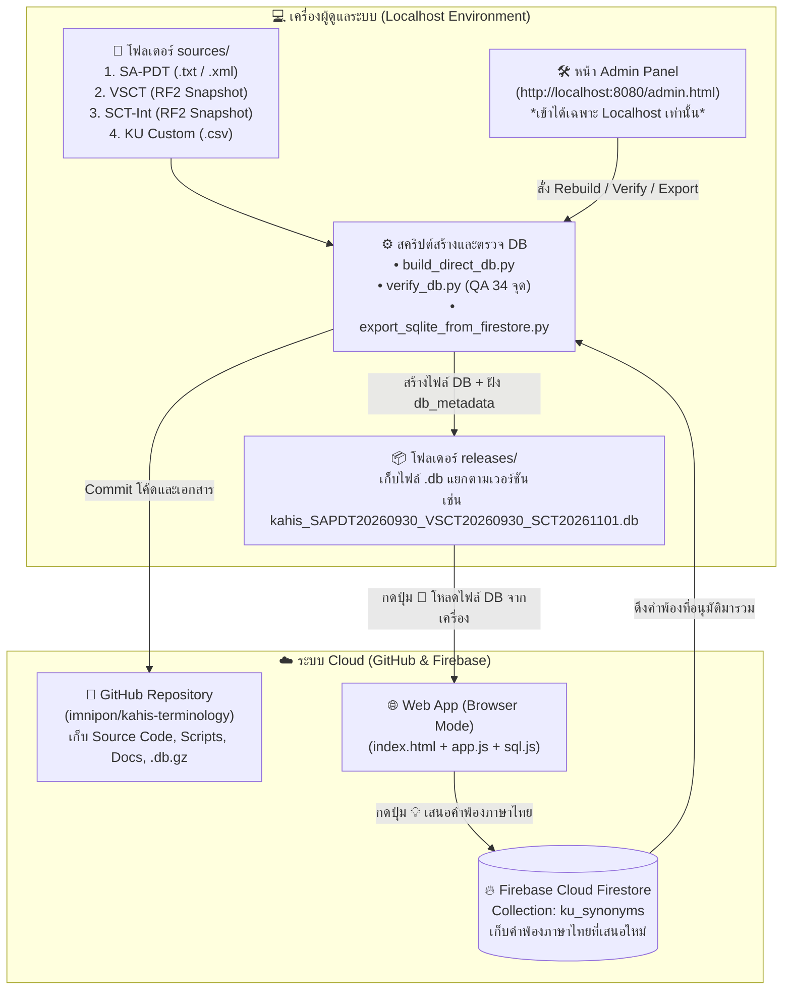

# คู่มือสถาปัตยกรรมระบบ KAHIS Terminology แบบ Hybrid (GitHub + Firebase + Localhost Builder + Browser SQLite Loader)

> **วันที่จัดทำเอกสาร:** 6 พฤศจิกายน 2026  
> **วัตถุประสงค์:** สรุปแนวทางการออกแบบสถาปัตยกรรมระบบ KAHIS Terminology ที่แยกส่วนการทำงานระหว่าง **ระบบค้นหาและเสนอคำพ้องบนเว็บ (Browser Mode)** กับ **ระบบสร้างและบริหารจัดการฐานข้อมูลบนเครื่องผู้ดูแล (Localhost Admin Builder)**

---

## 1. แนวคิดหลักของสถาปัตยกรรม (Core Architectural Concept)

เนื่องจากฐานข้อมูลคำศัพท์สัตวแพทย์ (`terminology_search.db`) ซึ่งรวบรวมข้อมูลจาก 3 แหล่งมาตรฐานสากล (`SA-PDT` + `VSCT` + `SNOMED CT International`) และข้อมูลความสัมพันธ์ (`relationships` กว่า 1.35 ล้านแถว) มีขนาดไฟล์จริงประมาณ **205 MB** (และเมื่อบีบอัดเป็น `.db.gz` จะมีขนาดประมาณ **51–54 MB**):

1. **ข้อจำกัดของ Cloud / GitHub Release:** การอัปโหลดไฟล์ฐานข้อมูลขนาดใหญ่กว่า 200 MB ขึ้นคลาวด์โดยตรงหรือฝากไว้ในฟรีโฮสติ้งทั่วไปมีข้อจำกัดด้านขนาดไฟล์ แบนด์วิดท์ และหน่วยความจำ (RAM)
2. **แนวทางแก้ไขที่เหมาะสมที่สุดสำหรับโครงสร้างโปรเจกต์นี้:**
   - **การสร้างและอัปเดตฐานข้อมูล (DB Building & Admin):** ทำงานบน **Localhost (`http://localhost:8080/admin.html`)** ในเครื่องของผู้ดูแลระบบโดยตรง ซึ่งสามารถเข้าถึงไฟล์ต้นฉบับขนาดใหญ่ (ระดับหลายร้อย MB ถึง GB) และประมวลผลด้วย Python เสร็จภายใน 15–35 วินาที
   - **การค้นหาและทดสอบฐานข้อมูล (Browser Mode):** หน้าเว็บหลัก (`index.html`) ทำหน้าที่เป็น **Terminology Browser** ที่สามารถ:
     1. เชื่อมต่อค้นหาจากเซิร์ฟเวอร์ (Localhost หรือ Render)
     2. **โหลดไฟล์ `.db` จากเครื่องคอมพิวเตอร์ของผู้ใช้ขึ้นมาทำงานในเบราว์เซอร์โดยตรง (`📂 โหลดไฟล์ DB จากเครื่อง`)** ผ่านเทคโนโลยี **SQLite WebAssembly (`sql.js`)** โดยไม่ต้องอัปโหลดไฟล์ขนาด 205 MB ขึ้นอินเทอร์เน็ต
     3. **เสนอคำพ้องภาษาไทยเพิ่มเติม (`💡 เสนอคำพ้องภาษาไทย`)** โดยบันทึกลง **Firebase Cloud Firestore** แบบออนไลน์ได้ทันที เพื่อให้ผู้ดูแลระบบดึงมารวมในการสร้าง DB รอบถัดไป



---

## 2. บทบาทและการตั้งค่าของแต่ละองค์ประกอบ

### 2.1 GitHub Repository (`imnipon/kahis-terminology`)
- **หน้าที่:** เก็บซอร์สโค้ดทั้งหมดของโปรเจกต์ (`server.py`, `static/`, `scripts/`), เอกสารคู่มือ (`documents/`), และไฟล์คำพ้องมาตรฐาน (`ku_custom_synonyms.csv`)
- **การจัดการไฟล์ขนาดใหญ่ด้วย `.gitignore`:**
  - ไฟล์ฐานข้อมูลดิบ `*.db` (~205 MB) และโฟลเดอร์ไฟล์ต้นฉบับ `sources/1_SA-PDT/`, `sources/2_VSCT/`, `sources/3_SCT-Int/` จะถูกกำหนดไว้ใน `.gitignore` เพื่อไม่ให้ขนาดเกินขีดจำกัดของ GitHub (100 MB ต่อไฟล์)
  - อนุญาตเฉพาะไฟล์บีบอัด `.db.gz` (~51–54 MB) หากต้องการใช้เป็นฐานข้อมูลตั้งต้นสำหรับเซิร์ฟเวอร์ทดสอบ

### 2.2 Firebase (`kahis-terminology`)
- **Project ID:** `kahis-terminology`
- **Cloud Firestore (`ku_synonyms` Collection):**
  - ใช้ฐานข้อมูล `(default)` ซึ่งสร้างเสร็จสมบูรณ์แล้ว (หมายเหตุ: ในหน้าสร้างฐานข้อมูลของ Firebase เมื่อสร้าง `(default)` เสร็จแล้ว ระบบจะล็อก Location ตามค่าเริ่มต้นของโปรเจกต์ไว้ถาวร จึงไม่ต้องกดเลือก Location ซ้ำอีก)
  - เมื่อสัตวแพทย์หรือผู้ใช้งานกดปุ่ม **`💡 เสนอคำพ้องภาษาไทย`** ในหน้า Browser ข้อมูลจะถูกบันทึกเข้าสู่ Collection `ku_synonyms` โดยมีโครงสร้างฟิลด์ดังนี้:
    - `concept_id`: รหัส Concept ID (เช่น `"70650003"`)
    - `synonym_text`: คำพ้องภาษาไทยหรือคำย่อที่เสนอ (เช่น `"นิ่วในกระเพาะปัสสาวะ"`)
    - `lang_tag`: `"ku"`
    - `status`: `"pending"` (รออนุมัติ) หรือ `"approved"` (อนุมัติแล้ว)
    - `submitted_by`: ชื่อผู้เสนอ
    - `clinical_note`: หมายเหตุทางคลินิก
    - `created_at`: วันเวลาที่บันทึก (`ISO 8601`)
- **ความปลอดภัยของหน้า Admin บน Cloud:**
  - ในไฟล์ `firebase.json` ได้ตั้งค่า `"ignore": ["admin.html", "scripts/**", "*.db", "*.db.gz", "server.py"]` เพื่อไม่ให้ไฟล์ Admin ถูกอัปโหลดขึ้น Firebase Hosting
  - ในไฟล์ `server.py` มีฟังก์ชัน `is_local_client()` ตรวจสอบ IP ของผู้เรียก หากไม่ใช่ `127.0.0.1` หรือ `::1` (Localhost) ระบบจะส่ง `HTTP 403 Forbidden` ทันทีเมื่อพยายามเข้าถึง `/admin.html` หรือ `/api/admin/*`

### 2.3 หน้า Browser สำหรับค้นหาและทดสอบ DB (`static/index.html` & `static/app.js`)
1. **ปุ่ม `📂 โหลดไฟล์ DB จากเครื่อง` (Client-Side SQLite WASM):**
   - ใช้ไลบรารี `sql.js` (WebAssembly) เปิดไฟล์ `.db` (เช่น `terminology_search.db` หรือไฟล์ในโฟลเดอร์ `releases/`) จากฮาร์ดดิสก์ของผู้ใช้ขึ้นมาทำงานในหน่วยความจำของเบราว์เซอร์โดยตรง
   - ช่วยให้สามารถทดสอบฐานข้อมูลตัวเต็มขนาด 205 MB ที่เพิ่งสร้างเสร็จใหม่ๆ หรือสลับเปรียบเทียบระหว่างไฟล์ DB รุ่นเก่ากับรุ่นใหม่ได้ทันทีโดยไม่ต้องพึ่งพาการอัปโหลดขึ้นเซิร์ฟเวอร์
2. **การแสดงป้ายเวอร์ชันของ 3 แหล่งข้อมูล (`Release Version Badges`):**
   - มุมขวาบนของหน้า Browser แสดงป้ายกำกับ 3 แหล่งตามลำดับความสำคัญ:
     - 🟦 **`SA-PDT <YYYYMMDD>`**
     - 🟩 **`VSCT <YYYYMMDD>`**
     - ⬜ **`SCT <YYYYMMDD>`**
   - ป้ายทั้ง 3 นี้จะอ่านค่าจากตาราง `db_metadata` ที่ฝังอยู่ในไฟล์ `.db` ก้อนที่กำลังเปิดใช้งานอยู่

---

## 3. โครงสร้างโฟลเดอร์มาตรฐานสำหรับสร้าง DB บน Localhost

เพื่อให้การทำงานของหน้า Admin บน Localhost มีความเป็นระเบียบ ไม่ปะปนกับโฟลเดอร์ `Downloads` ของเครื่อง และระบุเวอร์ชันได้แม่นยำ โครงสร้างโฟลเดอร์ของโปรเจกต์จึงแบ่งออกเป็นดังนี้:

```text
d:\imnipon_project\kahis-terminology\
│
├── 📂 sources\                             <-- ที่วางไฟล์ต้นฉบับสำหรับสร้าง DB (Localhost เท่านั้น, อยู่ใน .gitignore)
│   ├── 📂 1_SA-PDT\                        <-- วางไฟล์ SA-PDTReleaseFile_full_YYYYMMDD.txt / .xml และไฟล์ Changes
│   ├── 📂 2_VSCT\                          <-- วางโฟลเดอร์หรือ .zip ของ SnomedCT_VETExtension_*_YYYYMMDD*
│   ├── 📂 3_SCT-Int\                       <-- วางโฟลเดอร์หรือ .zip ของ SnomedCT_InternationalRF2_*_YYYYMMDD*
│   └── 📂 4_KU-Custom\                     <-- เก็บไฟล์ ku_custom_synonyms.csv (Track ลง Git ได้)
│
├── 📂 releases\                            <-- คลังเก็บไฟล์ SQLite DB ที่สร้างเสร็จแล้ว ตั้งชื่อตามเวอร์ชันทั้ง 3 แหล่ง
│   ├── kahis_SAPDT20260331_VSCT20260331_SCT20260701.db
│   └── kahis_SAPDT20260930_VSCT20260930_SCT20261101.db
│
├── 📂 backup\                              <-- สำรองฐานข้อมูลอัตโนมัติก่อนการสั่ง Rebuild ทุกครั้ง
├── 📂 output\                              <-- เก็บไฟล์ CSV ที่ส่งออกจากหน้า Admin (master_kahis_terminology.csv ฯลฯ)
├── 📂 scripts\                             <-- สคริปต์ประมวลผล (build_direct_db.py, verify_db.py, export_sqlite_from_firestore.py)
├── 📂 documents\                           <-- เอกสารคู่มือและรายงานการวิเคราะห์ทั้งหมดของโปรเจกต์
├── 📂 static\                              <-- หน้าเว็บ Frontend (index.html, admin.html, app.js, style.css)
└── 📄 server.py                            <-- เซิร์ฟเวอร์หลักสำหรับรันบน Localhost (พอร์ต 8080)
```

---

## 4. มาตรฐานการระบุเวอร์ชันของฐานข้อมูล (3-Source Version Identity)

เนื่องจากฐานข้อมูล KAHIS ประกอบขึ้นจากข้อมูล 3 แหล่งที่มีรอบการออกรุ่น (Release Cycle) ต่างกัน การระบุเวอร์ชันจึงใช้ระบบ **"ระบุวันที่ของทั้ง 3 แหล่งควบคู่กัน"** ดังนี้:

1. **ตาราง `db_metadata` ภายในไฟล์ SQLite:**
   ทุกครั้งที่รัน `build_direct_db.py` ระบบจะบันทึกข้อมูลรุ่นลงในตาราง `db_metadata` ภายในไฟล์ `.db`:
   - `sapdt_version`: เช่น `20260930`
   - `vsct_version`: เช่น `20260930`
   - `sct_version`: เช่น `20261101`
   - `sapdt_badge`: `SA-PDT 20260930`
   - `vsct_badge`: `VSCT 20260930`
   - `sct_badge`: `SCT 20261101`
   - `release_tag`: `SAPDT20260930_VSCT20260930_SCT20261101`
   - `built_at`: วันและเวลาที่สร้างฐานข้อมูล
2. **การตั้งชื่อไฟล์ในโฟลเดอร์ `releases/`:**
   - ใช้รูปแบบ `kahis_SAPDT<YYYYMMDD>_VSCT<YYYYMMDD>_SCT<YYYYMMDD>.db`
   - ทำให้ผู้ใช้งานสามารถเลือกไฟล์จากโฟลเดอร์ `releases/` ผ่านปุ่ม **`📂 โหลดไฟล์ DB จากเครื่อง`** ในหน้า Browser ได้อย่างชัดเจน และป้ายเวอร์ชันมุมขวาบนของหน้า Browser จะเปลี่ยนตามไฟล์ `.db` ที่เลือกโดยอัตโนมัติ
